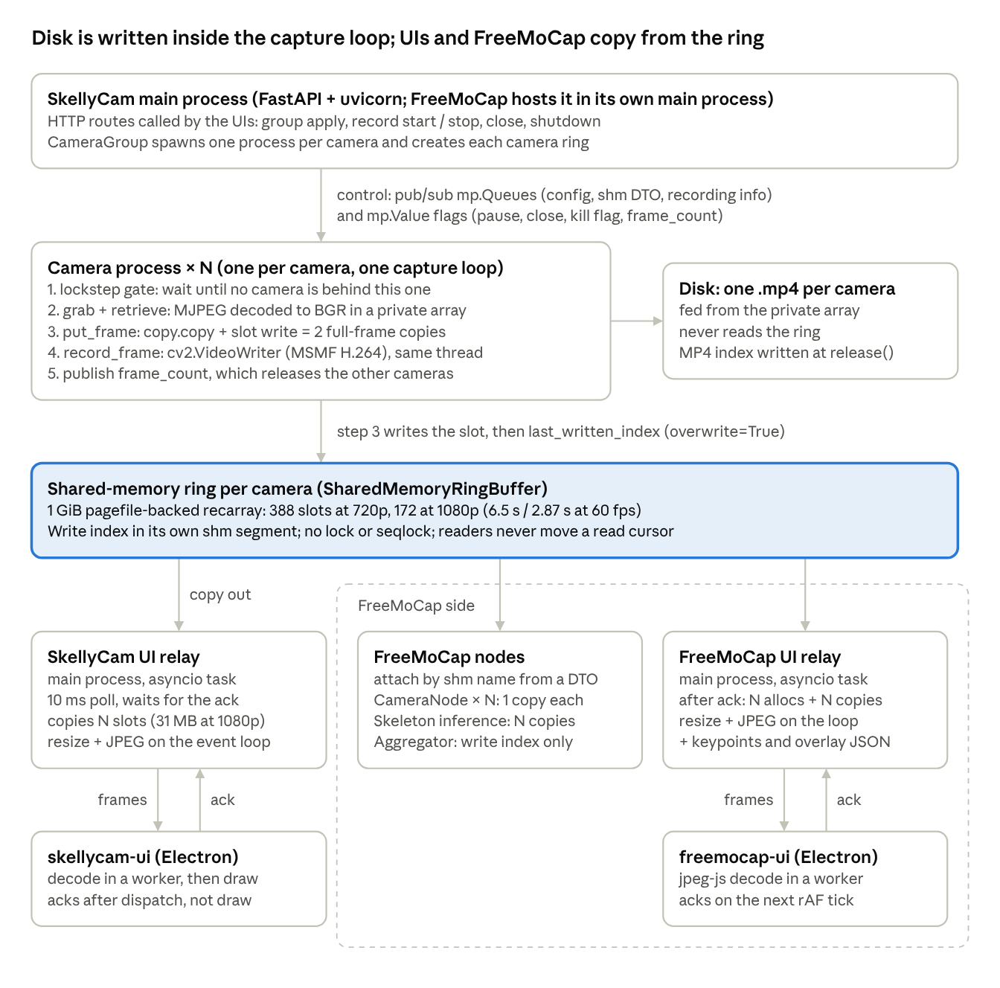
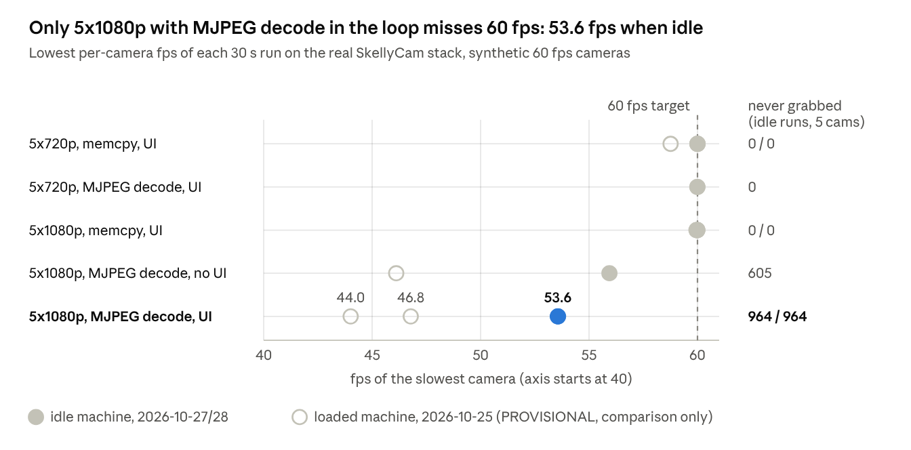
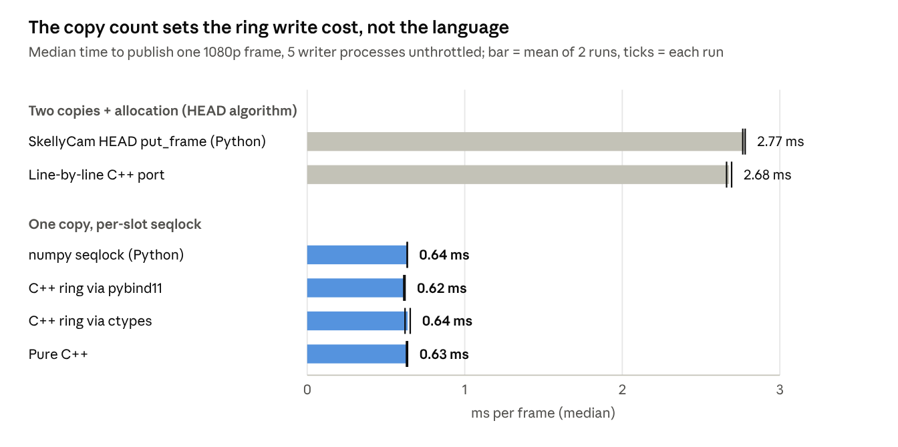
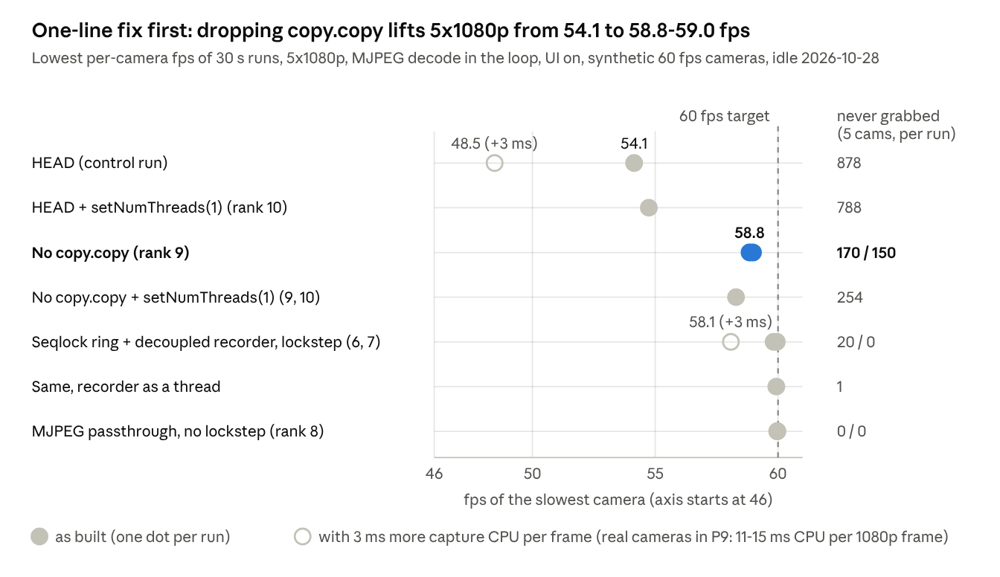

# SkellyCam → FreeMoCap Frame Ring Buffer: Analysis & Throughput Plan

Oct 28, 2026 · Dom

> Exported on 2026-10-28 from the online doc this study was first written in. This file is now the canonical copy; corrections made after export are marked "(corrected 2026-10-28; was ...)".

## Summary

SkellyCam does not hold 5 cameras at 1080p60 today, and the frames it misses are not counted. On an idle machine the real stack, with MJPEG decode in the capture loop, ran at 53.56 / 53.57 fps per camera. 964 sensor frames (10.7%) were never grabbed, and the recording finalizer still passed (`baseline/results/e_e2e_summary.md`; `bench_e_e2e.py 1080p mjpeg ui 30`; reproduced at 53.92 / 53.97 fps in `reproducibility/comparison.md`).

Every frame that was grabbed reached the video writer. In 8 end-to-end runs and 6 recorder configurations the files decoded to exactly the recorded count (`baseline/results/e_e2e_summary.md`, `c_record.md`). Those files sat in the OS page cache; the physical disk was tested separately (P12, below).

A C++ port is not needed. A line-by-line port of `put_frame` is 2-7% faster; with the same one-copy design, numpy and C++ are within 1-4% (`cpp/results/cpp_comparison.md` section 1a; `cpp/run_all.py`).

| Priority | State at the pinned commit | First changes (rank in Recommendations) | Evidence |
| --- | --- | --- | --- |
| P1: no dropped disk writes | No grabbed frame was lost in tests. But any UI, websocket or FreeMoCap-node exception sets the global kill flag, and a killed MSMF .mp4 keeps 0 of 300 frames. Sensor-level loss is not counted. | Contain failures (1), crash-tolerant files (2), no stale re-record (3), guard recording state (4), count drops (5) | [websocket\_server.py L262-276](https://github.com/freemocap/skellycam/blob/23ccbf208e43879bfc74fc01049e5af2a623933d/skellycam/api/websocket/websocket_server.py#L262-L276); `prototypes/results/p11_crash_container.md` (`p11_crash_container.py`) |
| P2: 5 cameras at 60 fps | 53.6 fps at 5x1080p with decode in the loop; 60.00 fps at 5x720p | Remove `copy.copy` (9): 58.84 / 58.98 fps alone. Ring v2 + decoupled recorder (6, 7): 59.82 / 59.95 fps in a prototype | `baseline/results/e2ev_summary.md`; `prototypes/results/p8v_e2e_summary.md` (both via `revision/run_revision.py`) |
| P3: no needless copies | 2 full-frame copies per captured frame, 5 per UI multiframe (31.1 MB at 1080p), 2N per FreeMoCap processed multiframe | Remove `copy.copy` (9), retrieve into the slot (11), validated views for readers (6, 12, 15) | `baseline/results/f_copies.md` (`bench_f_copies.py`) |

All 5x60 numbers use synthetic 60 fps cameras: no attached UVC camera delivered more than 30.1 fps (`prototypes/results/p9_real_camera.md`). The headroom is small: 3 ms more CPU per frame drops the prototype to 58.08 fps (`p8v_e2e_summary.md`).

Paths are relative to `skellycam/research/frame_ring_buffer/`. Numbers were measured idle on 2026-10-27/28 unless marked PROVISIONAL; commands are in Reproducing the results.

## Architecture overview

Each camera runs in its own process and writes into its own shared-memory ring. The disk writer runs inside that same capture loop; both UIs and FreeMoCap copy frames out of the rings.



*Source: SkellyCam 23ccbf20 and FreeMoCap 5632778a · from study_state/verified_digest.json (flow, per area)*

Control flows down from the main process; frames flow down from the capture loop. The SkellyCam → FreeMoCap handoff is the attach: FreeMoCap processes open the same rings by name and copy the frames they need. FreeMoCap's venv runs SkellyCam 777b058c, whose tree matches 23ccbf20 for this code (verified\_digest.json, version\_diffs).

| Part | Code |
| --- | --- |
| One OS process per camera (`WorkerMode.PROCESS`) | [skellycam/**main**.py L39-43](https://github.com/freemocap/skellycam/blob/23ccbf208e43879bfc74fc01049e5af2a623933d/skellycam/__main__.py#L39-L43), [camera\_manager.py L68-81](https://github.com/freemocap/skellycam/blob/23ccbf208e43879bfc74fc01049e5af2a623933d/skellycam/core/camera/camera_manager.py#L68-L81), [freemocap/**main**.py L57-61](https://github.com/freemocap/freemocap/blob/5632778af10e22befd4ec0a719ba844f14a84e93/freemocap/__main__.py#L57-L61) |
| Capture loop: gate, grab / retrieve, put\_frame, record\_frame, frame\_count | [opencv\_camera\_loop.py L43-117](https://github.com/freemocap/skellycam/blob/23ccbf208e43879bfc74fc01049e5af2a623933d/skellycam/core/camera/opencv/opencv_camera_loop.py#L43-L117) |
| Lockstep gate | [camera\_orchestrator.py L96-109](https://github.com/freemocap/skellycam/blob/23ccbf208e43879bfc74fc01049e5af2a623933d/skellycam/core/camera_group/camera_orchestrator.py#L96-L109) |
| Ring size (1 GiB // record size) and the overwrite write | [ring\_buffer\_shared\_memory.py L34-52](https://github.com/freemocap/skellycam/blob/23ccbf208e43879bfc74fc01049e5af2a623933d/skellycam/core/ipc/shared_memory/ring_buffer_shared_memory.py#L34-L52), [L118-133](https://github.com/freemocap/skellycam/blob/23ccbf208e43879bfc74fc01049e5af2a623933d/skellycam/core/ipc/shared_memory/ring_buffer_shared_memory.py#L118-L133) |
| Rings created by the main process, DTO sent to the cameras | [camera\_group.py L104-119](https://github.com/freemocap/skellycam/blob/23ccbf208e43879bfc74fc01049e5af2a623933d/skellycam/core/camera_group/camera_group.py#L104-L119) |
| Recorder (cv2.VideoWriter; MSMF on Windows) | [video\_recorder.py L87-130](https://github.com/freemocap/skellycam/blob/23ccbf208e43879bfc74fc01049e5af2a623933d/skellycam/core/recorders/videos/video_recorder.py#L87-L130) |
| SkellyCam UI relay | [websocket\_server.py L189-212](https://github.com/freemocap/skellycam/blob/23ccbf208e43879bfc74fc01049e5af2a623933d/skellycam/api/websocket/websocket_server.py#L189-L212), [camera\_group\_shared\_memory.py L129-141](https://github.com/freemocap/skellycam/blob/23ccbf208e43879bfc74fc01049e5af2a623933d/skellycam/core/ipc/shared_memory/camera_group_shared_memory.py#L129-L141), [frontend\_payload\_bytearray.py L41-199](https://github.com/freemocap/skellycam/blob/23ccbf208e43879bfc74fc01049e5af2a623933d/skellycam/core/types/frontend_payload_bytearray.py#L41-L199) |
| skellycam-ui decode, draw and ack | [ServerContextProvider.tsx L169-245](https://github.com/freemocap/skellycam/blob/23ccbf208e43879bfc74fc01049e5af2a623933d/skellycam-ui/src/services/server/ServerContextProvider.tsx#L169-L245) |
| FreeMoCap attach and frame readers | [realtime\_pipeline.py L141-272](https://github.com/freemocap/freemocap/blob/5632778af10e22befd4ec0a719ba844f14a84e93/freemocap/core/pipeline/realtime/realtime_pipeline.py#L141-L272), [camera\_node.py L251-352](https://github.com/freemocap/freemocap/blob/5632778af10e22befd4ec0a719ba844f14a84e93/freemocap/core/pipeline/realtime/camera_node.py#L251-L352), [realtime\_skeleton\_inference\_node.py L173-307](https://github.com/freemocap/freemocap/blob/5632778af10e22befd4ec0a719ba844f14a84e93/freemocap/core/pipeline/realtime/realtime_skeleton_inference_node.py#L173-L307), [realtime\_aggregator\_node.py L445-458](https://github.com/freemocap/freemocap/blob/5632778af10e22befd4ec0a719ba844f14a84e93/freemocap/core/pipeline/realtime/realtime_aggregator_node.py#L445-L458) |
| FreeMoCap UI relay | [freemocap websocket\_server.py L239-266](https://github.com/freemocap/freemocap/blob/5632778af10e22befd4ec0a719ba844f14a84e93/freemocap/api/websocket/websocket_server.py#L239-L266), [realtime\_pipeline.py L461-519](https://github.com/freemocap/freemocap/blob/5632778af10e22befd4ec0a719ba844f14a84e93/freemocap/core/pipeline/realtime/realtime_pipeline.py#L461-L519) |
| freemocap-ui ack and decode | [ServerContextProvider.tsx L314-371](https://github.com/freemocap/freemocap/blob/5632778af10e22befd4ec0a719ba844f14a84e93/freemocap-ui/src/services/server/ServerContextProvider.tsx#L314-L371), [binary-frame-parser.ts L252-287](https://github.com/freemocap/freemocap/blob/5632778af10e22befd4ec0a719ba844f14a84e93/freemocap-ui/src/services/server/server-helpers/frame-processor/binary-frame-parser.ts#L252-L287) |

## Write path into the ring buffer

Each camera process decodes a frame into private memory, then `put_frame` copies it into the ring twice; one of the two copies does nothing useful. The steps per frame, all on one thread of the camera process ([opencv\_camera\_loop.py L43-117](https://github.com/freemocap/skellycam/blob/23ccbf208e43879bfc74fc01049e5af2a623933d/skellycam/core/camera/opencv/opencv_camera_loop.py#L43-L117)):

1. Setup, once. The main process creates a 1 GiB ring per camera and sends its DTO over a `multiprocessing.Queue`; the camera attaches as writer ([camera\_group.py L104-119](https://github.com/freemocap/skellycam/blob/23ccbf208e43879bfc74fc01049e5af2a623933d/skellycam/core/camera_group/camera_group.py#L104-L119), [setup\_opencv\_camera\_loop.py L31-77](https://github.com/freemocap/skellycam/blob/23ccbf208e43879bfc74fc01049e5af2a623933d/skellycam/core/camera/opencv/opencv_helpers/setup_opencv_camera_loop.py#L31-L77)). Slots = 1 GiB // record size: 388 at 720p, 172 at 1080p. A record is 632 B of metadata followed by the image ([ring\_buffer\_shared\_memory.py L34-52](https://github.com/freemocap/skellycam/blob/23ccbf208e43879bfc74fc01049e5af2a623933d/skellycam/core/ipc/shared_memory/ring_buffer_shared_memory.py#L34-L52), [numpy\_record\_dtypes.py L10-33](https://github.com/freemocap/skellycam/blob/23ccbf208e43879bfc74fc01049e5af2a623933d/skellycam/core/types/numpy_record_dtypes.py#L10-L33)).
2. Control checks: recording info, config update, pause, close ([opencv\_camera\_loop.py L43-65](https://github.com/freemocap/skellycam/blob/23ccbf208e43879bfc74fc01049e5af2a623933d/skellycam/core/camera/opencv/opencv_camera_loop.py#L43-L65)).
3. Lockstep gate: grab only when every camera is ready and none has a lower `frame_count`; otherwise `time.sleep(1e-5)`, which takes 0.525 ms median on this machine ([camera\_orchestrator.py L96-109](https://github.com/freemocap/skellycam/blob/23ccbf208e43879bfc74fc01049e5af2a623933d/skellycam/core/camera_group/camera_orchestrator.py#L96-L109), [wait\_functions.py L29-30](https://github.com/freemocap/skellycam/blob/23ccbf208e43879bfc74fc01049e5af2a623933d/skellycam/utilities/wait_functions.py#L29-L30); `cpp/results/micro_py.json` from `cpp/py_micro.py`).
4. `cap.grab()`, then `cap.retrieve(image=<private view>)`: MJPEG is decoded to BGR in the process-private recarray, `frame_number` goes up by 1 and a text overlay is drawn. Up to 30 retries ([opencv\_get\_frame.py L53-91](https://github.com/freemocap/skellycam/blob/23ccbf208e43879bfc74fc01049e5af2a623933d/skellycam/core/camera/opencv/opencv_helpers/opencv_get_frame.py#L53-L91), [create\_initial\_frame\_recarray.py L8-19](https://github.com/freemocap/skellycam/blob/23ccbf208e43879bfc74fc01049e5af2a623933d/skellycam/core/camera/opencv/opencv_helpers/create_initial_frame_recarray.py#L8-L19)).
5. `put_frame(overwrite=True)`: `buffer[i % L] = copy(data)`, then `last_written_index = i`. There is no lock, seqlock or fence; only program order separates the slot write from the index store ([ring\_buffer\_shared\_memory.py L118-133](https://github.com/freemocap/skellycam/blob/23ccbf208e43879bfc74fc01049e5af2a623933d/skellycam/core/ipc/shared_memory/ring_buffer_shared_memory.py#L118-L133)).
6. If recording: `record_frame` encodes the private array with a synchronous `cv2.VideoWriter.write` ([video\_recorder.py L87-109](https://github.com/freemocap/skellycam/blob/23ccbf208e43879bfc74fc01049e5af2a623933d/skellycam/core/recorders/videos/video_recorder.py#L87-L109)).
7. `check_framerate_reset`, then publish `frame_count`, which opens the other cameras' gates ([opencv\_camera\_loop.py L106-117](https://github.com/freemocap/skellycam/blob/23ccbf208e43879bfc74fc01049e5af2a623933d/skellycam/core/camera/opencv/opencv_camera_loop.py#L106-L117)).

| Copy on the write path | Bytes per 1080p frame | Needed? | Code |
| --- | --- | --- | --- |
| `copy.copy(data)` into a new heap array | 6,221,432 | No: the slot assignment already copies | [ring\_buffer\_shared\_memory.py L132](https://github.com/freemocap/skellycam/blob/23ccbf208e43879bfc74fc01049e5af2a623933d/skellycam/core/ipc/shared_memory/ring_buffer_shared_memory.py#L132) |
| Slot assignment into shared memory | 6,221,432 | Only while decode targets private memory (rank 11 removes it) | [ring\_buffer\_shared\_memory.py L132-133](https://github.com/freemocap/skellycam/blob/23ccbf208e43879bfc74fc01049e5af2a623933d/skellycam/core/ipc/shared_memory/ring_buffer_shared_memory.py#L132-L133) |
| `cv2.rotate` before encoding | 6,220,800 | Only when rotation is set | [video\_recorder.py L92-98](https://github.com/freemocap/skellycam/blob/23ccbf208e43879bfc74fc01049e5af2a623933d/skellycam/core/recorders/videos/video_recorder.py#L92-L98) |
| Per-frame metadata kept for the finalizer | 632 | Small | [video\_recorder.py L108](https://github.com/freemocap/skellycam/blob/23ccbf208e43879bfc74fc01049e5af2a623933d/skellycam/core/recorders/videos/video_recorder.py#L108) |

Byte counts: `baseline/results/f_copies.md` (`bench_f_copies.py`). The two `put_frame` copies move 3.73 GB/s at 5x1080p60, 1.87 GB/s of it avoidable. Isolated, `put_frame` costs 1.326 ms at 1080p against 0.172 ms for one `np.copyto` into the same slot (`baseline/results/a_write.md`, `bench_a_write.py`). Inside the real loop at 5x1080p MJPEG + UI it costs 3.64-3.73 ms (`baseline/results/e_e2e_summary.md`).

Write-path risks to P1:

- After 30 failed grabs the loop still puts and records the frame with an unchanged `frame_number`. During a recording that raises in `_validate_frame_number` and calls `kill_everything` ([opencv\_camera\_loop.py L72-105](https://github.com/freemocap/skellycam/blob/23ccbf208e43879bfc74fc01049e5af2a623933d/skellycam/core/camera/opencv/opencv_camera_loop.py#L72-L105), [L119-123](https://github.com/freemocap/skellycam/blob/23ccbf208e43879bfc74fc01049e5af2a623933d/skellycam/core/camera/opencv/opencv_camera_loop.py#L119-L123), [video\_recorder.py L149-156](https://github.com/freemocap/skellycam/blob/23ccbf208e43879bfc74fc01049e5af2a623933d/skellycam/core/recorders/videos/video_recorder.py#L149-L156)).
- A live resolution change leaves the private array at the old shape; OpenCV then decodes into a new array that is discarded, so stale pixels are written ([opencv\_get\_frame.py L71-73](https://github.com/freemocap/skellycam/blob/23ccbf208e43879bfc74fc01049e5af2a623933d/skellycam/core/camera/opencv/opencv_helpers/opencv_get_frame.py#L71-L73), [check\_for\_new\_config.py L15-43](https://github.com/freemocap/skellycam/blob/23ccbf208e43879bfc74fc01049e5af2a623933d/skellycam/core/camera/opencv/opencv_helpers/check_for_new_config.py#L15-L43)).
- A settings update on one camera sets `updating=True`, which closes the gate for every camera until it finishes ([check\_for\_new\_config.py L30-41](https://github.com/freemocap/skellycam/blob/23ccbf208e43879bfc74fc01049e5af2a623933d/skellycam/core/camera/opencv/opencv_helpers/check_for_new_config.py#L30-L41), [camera\_status.py L22-31](https://github.com/freemocap/skellycam/blob/23ccbf208e43879bfc74fc01049e5af2a623933d/skellycam/core/camera_group/camera_status.py#L22-L31)).
- `check_framerate_reset` uses a hard-coded 66.7 ms (30 fps) limit and can release and reopen the camera mid-recording ([opencv\_camera\_loop.py L150-170](https://github.com/freemocap/skellycam/blob/23ccbf208e43879bfc74fc01049e5af2a623933d/skellycam/core/camera/opencv/opencv_camera_loop.py#L150-L170)).

## Read paths from the ring buffer

Every production reader copies whole frames out by index and none of them consumes, so the writer never waits and a lagging reader is overwritten without notice. The disk recorder is not a ring reader at all: it encodes the camera's private array inside the capture loop ([opencv\_camera\_loop.py L95-105](https://github.com/freemocap/skellycam/blob/23ccbf208e43879bfc74fc01049e5af2a623933d/skellycam/core/camera/opencv/opencv_camera_loop.py#L95-L105), [handle\_video\_recording\_loop.py L13-37](https://github.com/freemocap/skellycam/blob/23ccbf208e43879bfc74fc01049e5af2a623933d/skellycam/core/camera/opencv/opencv_helpers/handle_video_recording_loop.py#L13-L37)).

| Reader | Where it runs | How it reads | Cost at 1080p (idle) | Code |
| --- | --- | --- | --- | --- |
| SkellyCam UI relay | Main process, asyncio event loop | `get_latest_multiframe`: index = min of the write heads, then one `np.copyto` per camera into reused arrays; raises `ValueError` if frame numbers differ | 2.353 ms for 5 cameras | [camera\_group\_shared\_memory.py L129-141](https://github.com/freemocap/skellycam/blob/23ccbf208e43879bfc74fc01049e5af2a623933d/skellycam/core/ipc/shared_memory/camera_group_shared_memory.py#L129-L141) |
| FreeMoCap UI relay | FreeMoCap main process, event loop | `get_images_by_frame_number`: allocates a new full-frame array per camera per call, because its cache is never filled | 6.628 ms for 5 cameras | [camera\_group\_shared\_memory.py L143-169](https://github.com/freemocap/skellycam/blob/23ccbf208e43879bfc74fc01049e5af2a623933d/skellycam/core/ipc/shared_memory/camera_group_shared_memory.py#L143-L169), [realtime\_pipeline.py L479-482](https://github.com/freemocap/freemocap/blob/5632778af10e22befd4ec0a719ba844f14a84e93/freemocap/core/pipeline/realtime/realtime_pipeline.py#L479-L482) |
| FreeMoCap CameraNode (one per camera) | Own process | `get_data_by_index(frame)` into a reused array; a frame-number mismatch only logs a warning | 0.423 ms per camera | [camera\_node.py L256-280](https://github.com/freemocap/freemocap/blob/5632778af10e22befd4ec0a719ba844f14a84e93/freemocap/core/pipeline/realtime/camera_node.py#L256-L280) |
| FreeMoCap SkeletonInferenceNode | Own process | `get_data_by_index(frame)` for every camera | N x 0.423 ms | [realtime\_skeleton\_inference\_node.py L400-421](https://github.com/freemocap/freemocap/blob/5632778af10e22befd4ec0a719ba844f14a84e93/freemocap/core/pipeline/realtime/realtime_skeleton_inference_node.py#L400-L421) |
| FreeMoCap Aggregator | Own process | Reads only the write index, no pixels | - | [realtime\_aggregator\_node.py L445-458](https://github.com/freemocap/freemocap/blob/5632778af10e22befd4ec0a719ba844f14a84e93/freemocap/core/pipeline/realtime/realtime_aggregator_node.py#L445-L458) |

Costs are cold reads with 5 writers at 60 fps (`baseline/results/b_read.md`, `bench_b_read.py`). A view of the same slot costs 0.017 ms.

How the ring treats readers:

- Three read APIs exist; only `get_next_data` advances `last_read_index`, and no production code calls it. All three copy; none returns a view ([ring\_buffer\_shared\_memory.py L135-202](https://github.com/freemocap/skellycam/blob/23ccbf208e43879bfc74fc01049e5af2a623933d/skellycam/core/ipc/shared_memory/ring_buffer_shared_memory.py#L135-L202)).
- The writer always passes `overwrite=True`, so the overwrite guard never fires. It could not be switched on as is: with `last_read_index` stuck at -1 it would trip on the first wrap ([ring\_buffer\_shared\_memory.py L115-133](https://github.com/freemocap/skellycam/blob/23ccbf208e43879bfc74fc01049e5af2a623933d/skellycam/core/ipc/shared_memory/ring_buffer_shared_memory.py#L115-L133)).
- `get_data_by_index` checks for lag only before the copy, and accepts `head - index == L-1`, the slot written next ([ring\_buffer\_shared\_memory.py L175-202](https://github.com/freemocap/skellycam/blob/23ccbf208e43879bfc74fc01049e5af2a623933d/skellycam/core/ipc/shared_memory/ring_buffer_shared_memory.py#L175-L202)). In an adversarial test the copy-then-check pattern accepted 39,854-41,834 torn frames reading the oldest slot. At SkellyCam's real 720p ring (388 slots) with latest reads it accepted 0, so the exposure is a FreeMoCap reader that lags by about a ring length: 6.5 s at 720p, 2.87 s at 1080p (`prototypes/results/p2_seqlock_read.md` part A, `p2_seqlock_read.py`).
- `read_only=True` is advisory: the numpy view is writeable in every process ([shared\_memory\_element.py L34-82](https://github.com/freemocap/skellycam/blob/23ccbf208e43879bfc74fc01049e5af2a623933d/skellycam/core/ipc/shared_memory/shared_memory_element.py#L34-L82)).
- A `ValueError` from `get_latest_multiframe` inside the UI relay sets the global kill flag, which stops every camera loop and ends a recording ([websocket\_server.py L262-276](https://github.com/freemocap/skellycam/blob/23ccbf208e43879bfc74fc01049e5af2a623933d/skellycam/api/websocket/websocket_server.py#L262-L276), [camera\_group\_ipc.py L47-53](https://github.com/freemocap/skellycam/blob/23ccbf208e43879bfc74fc01049e5af2a623933d/skellycam/core/camera_group/camera_group_ipc.py#L47-L53)).

## Control messages

Every command enters as an HTTP request to the main process and reaches the cameras through per-subscriber `multiprocessing.Queue`s and lock-protected `multiprocessing.Value` flags. The camera loop polls both at the top of every frame. The websocket carries no commands: only frame acks, ping and telemetry ([websocket\_server.py L342-380](https://github.com/freemocap/skellycam/blob/23ccbf208e43879bfc74fc01049e5af2a623933d/skellycam/api/websocket/websocket_server.py#L342-L380)).

| Command | Route | What the main process does | What the camera does | Code |
| --- | --- | --- | --- | --- |
| Create group | POST `/skellycam/camera/group/apply` | Spawns one process per camera, waits for each extracted config, creates the rings, publishes `SetShmMessage` | Attaches to its ring and starts the loop | [camera\_router.py L113-132](https://github.com/freemocap/skellycam/blob/23ccbf208e43879bfc74fc01049e5af2a623933d/skellycam/api/http/cameras/camera_router.py#L113-L132), [camera\_group.py L104-119](https://github.com/freemocap/skellycam/blob/23ccbf208e43879bfc74fc01049e5af2a623933d/skellycam/core/camera_group/camera_group.py#L104-L119) |
| Update settings | Same route, existing group | Publishes `UpdateCamerasSettingsMessage`, waits for configs (100 ms polls) | Applies inline with `updating=True`, which closes the gate for all cameras | [camera\_group\_manager.py L73-83](https://github.com/freemocap/skellycam/blob/23ccbf208e43879bfc74fc01049e5af2a623933d/skellycam/core/camera_group/camera_group_manager.py#L73-L83), [check\_for\_new\_config.py L30-41](https://github.com/freemocap/skellycam/blob/23ccbf208e43879bfc74fc01049e5af2a623933d/skellycam/core/camera/opencv/opencv_helpers/check_for_new_config.py#L30-L41) |
| Start recording | POST `.../group/all/record/start` | Pauses all, sets `first_recording_frame_number = max(frame_count) + 3`, publishes `RecordingInfoMessage`, unpauses | Builds its `VideoRecorder` inline (codec probe included), waits until all cameras record | [camera\_group.py L183-213](https://github.com/freemocap/skellycam/blob/23ccbf208e43879bfc74fc01049e5af2a623933d/skellycam/core/camera_group/camera_group.py#L183-L213), [handle\_recording\_updates.py L15-48](https://github.com/freemocap/skellycam/blob/23ccbf208e43879bfc74fc01049e5af2a623933d/skellycam/core/camera/opencv/opencv_helpers/handle_recording_updates.py#L15-L48) |
| Stop recording | GET `.../group/all/record/stop` | Pauses all, sets `last = max + 3`, unpauses, polls for one `RecordingFinishedMessage` per camera every 100 ms, runs the finalizer | Releases the writer at `last`, sends all per-frame metadata in one pickled message | [camera\_group.py L215-238](https://github.com/freemocap/skellycam/blob/23ccbf208e43879bfc74fc01049e5af2a623933d/skellycam/core/camera_group/camera_group.py#L215-L238), [L317-379](https://github.com/freemocap/skellycam/blob/23ccbf208e43879bfc74fc01049e5af2a623933d/skellycam/core/camera_group/camera_group.py#L317-L379), [handle\_recording\_updates.py L50-59](https://github.com/freemocap/skellycam/blob/23ccbf208e43879bfc74fc01049e5af2a623933d/skellycam/core/camera/opencv/opencv_helpers/handle_recording_updates.py#L50-L59) |
| Pause / unpause | GET `.../group/all/pause_unpause` | Toggles `should_pause`, awaits `is_paused` | Stops grabbing while paused | [camera\_router.py L201-208](https://github.com/freemocap/skellycam/blob/23ccbf208e43879bfc74fc01049e5af2a623933d/skellycam/api/http/cameras/camera_router.py#L201-L208) |
| Close group | DELETE `.../group/close/all` | Stops any recording, sets close flags, spins until every camera reports closed (no timeout) | Leaves the loop | [camera\_group.py L240-271](https://github.com/freemocap/skellycam/blob/23ccbf208e43879bfc74fc01049e5af2a623933d/skellycam/core/camera_group/camera_group.py#L240-L271), [camera\_orchestrator.py L111-117](https://github.com/freemocap/skellycam/blob/23ccbf208e43879bfc74fc01049e5af2a623933d/skellycam/core/camera_group/camera_orchestrator.py#L111-L117) |
| Shut down | GET `/shutdown` | Sets `global_kill_flag`, SIGTERMs itself; `shutdown_all` joins each worker 3 s, then terminates | Exits when `should_continue` turns False | [shutdown.py L18-48](https://github.com/freemocap/skellycam/blob/23ccbf208e43879bfc74fc01049e5af2a623933d/skellycam/api/http/app/shutdown.py#L18-L48), [worker\_registry.py L161-207](https://github.com/freemocap/skellycam/blob/23ccbf208e43879bfc74fc01049e5af2a623933d/skellycam/core/ipc/process_management/worker_registry.py#L161-L207) |
| Lockstep, every frame | none | none | Grabs only when no camera has a lower `frame_count`, then publishes its own | [camera\_orchestrator.py L96-109](https://github.com/freemocap/skellycam/blob/23ccbf208e43879bfc74fc01049e5af2a623933d/skellycam/core/camera_group/camera_orchestrator.py#L96-L109) |

Transports:

- Pub/sub: 7 topics, one `multiprocessing.Queue` per subscriber, created only in the main process ([pubsub\_abcs.py L22-58](https://github.com/freemocap/skellycam/blob/23ccbf208e43879bfc74fc01049e5af2a623933d/skellycam/core/ipc/pubsub/pubsub_abcs.py#L22-L58), [pubsub\_manager.py L14-82](https://github.com/freemocap/skellycam/blob/23ccbf208e43879bfc74fc01049e5af2a623933d/skellycam/core/ipc/pubsub/pubsub_manager.py#L14-L82)). FRAMERATE is subscribed but never published ([camera\_group\_manager.py L47-49](https://github.com/freemocap/skellycam/blob/23ccbf208e43879bfc74fc01049e5af2a623933d/skellycam/core/camera_group/camera_group_manager.py#L47-L49)).
- Flags: `CameraStatus` holds 11 bool Values plus `frame_count`; `should_continue` = no group shutdown, no global kill, fresh heartbeat ([camera\_status.py L6-20](https://github.com/freemocap/skellycam/blob/23ccbf208e43879bfc74fc01049e5af2a623933d/skellycam/core/camera_group/camera_status.py#L6-L20), [camera\_group\_ipc.py L47-58](https://github.com/freemocap/skellycam/blob/23ccbf208e43879bfc74fc01049e5af2a623933d/skellycam/core/camera_group/camera_group_ipc.py#L47-L58)).
- Ring indices are `SharedMemoryNumber`s: 4,423 ns per write and 5,738 ns per read, against 53-60 ns for a numpy view (`cpp/results/micro_py.json`, `cpp/py_micro.py`; [shared\_memory\_number.py L23-33](https://github.com/freemocap/skellycam/blob/23ccbf208e43879bfc74fc01049e5af2a623933d/skellycam/core/ipc/shared_memory/shared_memory_number.py#L23-L33)).
- FreeMoCap calls the same `CameraGroup` methods directly, not over HTTP ([calibration\_router.py L138-176](https://github.com/freemocap/freemocap/blob/5632778af10e22befd4ec0a719ba844f14a84e93/freemocap/api/http/calibration/calibration_router.py#L138-L176)).

Control risks to P1 and P2:

- Any camera-loop exception, websocket task error or unintended worker exit sets the global kill flag, and the registry then SIGTERMs the app ([opencv\_camera\_loop.py L119-130](https://github.com/freemocap/skellycam/blob/23ccbf208e43879bfc74fc01049e5af2a623933d/skellycam/core/camera/opencv/opencv_camera_loop.py#L119-L130), [worker\_registry.py L83-109](https://github.com/freemocap/skellycam/blob/23ccbf208e43879bfc74fc01049e5af2a623933d/skellycam/core/ipc/process_management/worker_registry.py#L83-L109)).
- Settings updates are accepted during a recording and halt every camera while they apply (table above).
- Stop pauses capture while still recording. Measured cost: at most 1 skipped sensor tick between consecutive frames in the last 10 recorded frames per camera (`baseline/results/e2ev_gap_detector.md`, `baseline/analyze_gap_detector.py`).
- Finishing a 36,000-frame recording stalls the camera loop for about 387 ms plus 127 ms of pickling, and every camera waits through lockstep. PROVISIONAL: a 2026-10-25 map-stage probe on a loaded machine ([pubsub\_topics.py L44-62](https://github.com/freemocap/skellycam/blob/23ccbf208e43879bfc74fc01049e5af2a623933d/skellycam/core/ipc/pubsub/pubsub_topics.py#L44-L62); `study_state/verified_digest.json`, control area).
- The gate's back-off is `time.sleep(1e-5)`, which takes 0.525 ms median. In the real stack each camera idles 2.48 ms per frame at the gate (finalizer `TOTAL CAMERA IDLE TIME`, `baseline/results/e2ev_summary.md`, `bench_e2e_variants.py head 1080p mjpeg ui 30`).

## UI taps and SkellyCam → FreeMoCap handoff

Both UIs tap the ring from an asyncio task in the main process, and FreeMoCap receives frames only by attaching to SkellyCam's rings by name. No pixels travel over HTTP, queues or FreeMoCap's pub/sub.

| Tap | Runs in | What it reads | Measured rate, 5 cameras (idle, no browser) | Code |
| --- | --- | --- | --- | --- |
| SkellyCam UI | SkellyCam main process, `_frontend_image_relay` | Every 10 ms, if the last payload was acked: newest complete multiframe, resize to 0.5, JPEG q60, one binary message | 60.5 payloads/s at 720p, 46.0/s at 1080p | [websocket\_server.py L189-212](https://github.com/freemocap/skellycam/blob/23ccbf208e43879bfc74fc01049e5af2a623933d/skellycam/api/websocket/websocket_server.py#L189-L212), [frontend\_payload\_bytearray.py L41-199](https://github.com/freemocap/skellycam/blob/23ccbf208e43879bfc74fc01049e5af2a623933d/skellycam/core/types/frontend_payload_bytearray.py#L41-L199) |
| FreeMoCap UI, realtime pipeline on | FreeMoCap main process, its own websocket relay | The exact frame the keypoints came from (`get_frontend_payload_by_frame_number`), plus a keypoints binary and an overlay JSON | 58.3/s at 720p, 41.7/s at 1080p (image path only) | [freemocap websocket\_server.py L239-266](https://github.com/freemocap/freemocap/blob/5632778af10e22befd4ec0a719ba844f14a84e93/freemocap/api/websocket/websocket_server.py#L239-L266), [realtime\_pipeline.py L461-519](https://github.com/freemocap/freemocap/blob/5632778af10e22befd4ec0a719ba844f14a84e93/freemocap/core/pipeline/realtime/realtime_pipeline.py#L461-L519) |
| FreeMoCap UI, cameras only | FreeMoCap main process | Falls back to SkellyCam's newest-multiframe path | as SkellyCam UI | [freemocap\_application.py L174-190](https://github.com/freemocap/freemocap/blob/5632778af10e22befd4ec0a719ba844f14a84e93/freemocap/app/freemocap_application.py#L174-L190) |
| FreeMoCap posthoc | One VideoNode process per camera | The recorded files, not the ring | - | [video\_node.py L365-412](https://github.com/freemocap/freemocap/blob/5632778af10e22befd4ec0a719ba844f14a84e93/freemocap/core/pipeline/posthoc/video_node.py#L365-L412) |

Rates: `baseline/results/d_ui.md` (`bench_d_ui.py`). With the 10 ms sleep removed the 1080p build alone allows 110.3 payloads/s, so the sleep plus the about 9 ms build on one thread sets the 46/s. Inside the real stack at 1080p the UI got 36.6-40.8 payloads/s (`baseline/results/e_e2e_summary.md`). The browser sends its ack after handing bitmaps to the canvas workers, not after drawing ([skellycam-ui ServerContextProvider.tsx L205-215](https://github.com/freemocap/skellycam/blob/23ccbf208e43879bfc74fc01049e5af2a623933d/skellycam-ui/src/services/server/ServerContextProvider.tsx#L205-L215)).

The handoff, step by step:

1. FreeMoCap runs SkellyCam inside its own process: one uvicorn server, one SkellyCam `WorkerRegistry`, one shared `global_kill_flag` ([freemocap/**main**.py L57-100](https://github.com/freemocap/freemocap/blob/5632778af10e22befd4ec0a719ba844f14a84e93/freemocap/__main__.py#L57-L100), [app.py L368-388](https://github.com/freemocap/freemocap/blob/5632778af10e22befd4ec0a719ba844f14a84e93/freemocap/app/app.py#L368-L388)).
2. The UI creates the camera group through SkellyCam's own `/skellycam/camera/group/apply`, then calls POST `/freemocap/realtime/apply` ([realtime\_router.py L59-92](https://github.com/freemocap/freemocap/blob/5632778af10e22befd4ec0a719ba844f14a84e93/freemocap/api/http/realtime/realtime_router.py#L59-L92), [freemocap\_application.py L93-112](https://github.com/freemocap/freemocap/blob/5632778af10e22befd4ec0a719ba844f14a84e93/freemocap/app/freemocap_application.py#L93-L112)).
3. `RealtimePipeline` pickles `camera_group.shm.to_dto()` (shm names, dtype, shape) into each node's kwargs; each node re-attaches the rings by name ([realtime\_pipeline.py L141-168](https://github.com/freemocap/freemocap/blob/5632778af10e22befd4ec0a719ba844f14a84e93/freemocap/core/pipeline/realtime/realtime_pipeline.py#L141-L168), [camera\_node.py L155-158](https://github.com/freemocap/freemocap/blob/5632778af10e22befd4ec0a719ba844f14a84e93/freemocap/core/pipeline/realtime/camera_node.py#L155-L158)).
4. The Aggregator reads only the newest complete frame number and publishes `ProcessFrameNumberMessage` ([realtime\_aggregator\_node.py L438-459](https://github.com/freemocap/freemocap/blob/5632778af10e22befd4ec0a719ba844f14a84e93/freemocap/core/pipeline/realtime/realtime_aggregator_node.py#L438-L459)).
5. Each CameraNode, and the SkeletonInferenceNode for all cameras, copies that frame out by index. Only observations go back, through the main-process pub/sub relay ([camera\_node.py L251-352](https://github.com/freemocap/freemocap/blob/5632778af10e22befd4ec0a719ba844f14a84e93/freemocap/core/pipeline/realtime/camera_node.py#L251-L352), [realtime\_skeleton\_inference\_node.py L163-242](https://github.com/freemocap/freemocap/blob/5632778af10e22befd4ec0a719ba844f14a84e93/freemocap/core/pipeline/realtime/realtime_skeleton_inference_node.py#L163-L242), [pubsub\_topics.py L38-70](https://github.com/freemocap/freemocap/blob/5632778af10e22befd4ec0a719ba844f14a84e93/freemocap/pubsub/pubsub_topics.py#L38-L70)).
6. The main-process relay waits for the browser ack, marks the result consumed, reads that frame's images, and sends overlay JSON, keypoints and JPEGs on one websocket. The pipeline's rate is tied to this ack loop (the two websocket and pipeline refs in the table above).
7. Recording start and stop from FreeMoCap are direct Python calls into SkellyCam's `CameraGroupManager` ([calibration\_router.py L138-176](https://github.com/freemocap/freemocap/blob/5632778af10e22befd4ec0a719ba844f14a84e93/freemocap/api/http/calibration/calibration_router.py#L138-L176), [mocap\_router.py L201-234](https://github.com/freemocap/freemocap/blob/5632778af10e22befd4ec0a719ba844f14a84e93/freemocap/api/http/mocap/mocap_router.py#L201-L234)).

Copies: in the default config (centralized inference, charuco on) each processed multiframe is copied 2N times at full resolution, plus N per UI frame. The CameraNodes copy even when they have no tracker ([camera\_node.py L256-267](https://github.com/freemocap/freemocap/blob/5632778af10e22befd4ec0a719ba844f14a84e93/freemocap/core/pipeline/realtime/camera_node.py#L256-L267), [realtime\_skeleton\_inference\_node.py L400-433](https://github.com/freemocap/freemocap/blob/5632778af10e22befd4ec0a719ba844f14a84e93/freemocap/core/pipeline/realtime/realtime_skeleton_inference_node.py#L400-L433)). Per 1080p UI multiframe, 31.1 MB leaves shared memory (`baseline/results/f_copies.md`).

Risks across the boundary:

- FreeMoCap's `PipelineIPC` uses SkellyCam's kill flag. Any exception in a CameraNode, the Aggregator (including `WRONG FRAME`) or the inference node calls `kill_everything()`, which stops capture and any recording ([realtime\_pipeline.py L114-119](https://github.com/freemocap/freemocap/blob/5632778af10e22befd4ec0a719ba844f14a84e93/freemocap/core/pipeline/realtime/realtime_pipeline.py#L114-L119), [pipeline\_ipc.py L52-70](https://github.com/freemocap/freemocap/blob/5632778af10e22befd4ec0a719ba844f14a84e93/freemocap/core/pipeline/abcs/pipeline_ipc.py#L52-L70)).
- The UI copy, resize and JPEG run on the same event loop as the recording start and stop handlers; at 1080p this blocked the loop 8.28 ms median per payload (`prototypes/results/p6_ui_path.md`, row `cur_copy_real`, `p6_ui_path.py`).
- Any unexpected error in a SkellyCam websocket task, including a malformed client message, sets the global kill flag ([websocket\_server.py L184-391](https://github.com/freemocap/skellycam/blob/23ccbf208e43879bfc74fc01049e5af2a623933d/skellycam/api/websocket/websocket_server.py#L184-L391)).
- skellycam-ui has no ack timeout: one failed decode freezes the stream until reconnect ([ServerContextProvider.tsx L169-233](https://github.com/freemocap/skellycam/blob/23ccbf208e43879bfc74fc01049e5af2a623933d/skellycam-ui/src/services/server/ServerContextProvider.tsx#L169-L233)).

## Measured baseline

On an idle machine the unmodified stack holds 60 fps at 5x720p and at 5x1080p without decode, but not at 5x1080p with the MJPEG decode in the capture loop. No grabbed frame was lost on the way to the writer in any run (`baseline/results/e_e2e_summary.md`, `c_record.md`).



*Source: baseline/results/e_e2e_summary.md (bench_e_e2e.py <size> <mjpeg|memcpy> <ui|noui> 30) and results_provisional_20261025/ · 5 configurations, 16 runs*

The end-to-end runs use the real `WorkerRegistry`, `CameraGroup` and camera processes with a `FakeCapture` that ticks at 60 fps. "MJPEG decode" decodes a q90 JPEG inside `retrieve()`; "memcpy" copies a ready frame. Which of the two a real DSHOW camera resembles is still open. At 5x1080p MJPEG + UI the loop spends retrieve 10.12-10.31 ms, `put_frame` 3.64-3.73 ms and `record_frame` 1.12-1.19 ms, with a group frame interval of 18.69 ms median (`baseline/results/e_e2e_1080p_mjpeg_ui.json`, `_rep2.json`). The reproducibility re-run gave 53.92 / 53.97 fps and 911 / 902 never grabbed (`reproducibility/comparison.md`).

| Component (idle, 2026-10-27/28) | 720p | 1080p | Meets 5x60? | Result file (script) |
| --- | --- | --- | --- | --- |
| `put_frame`, 5 unthrottled writers: median, slowest camera | 1.145 ms, 839 fps | 2.747 ms, 353 fps | yes | `baseline/results/a_write.md` (`bench_a_write.py`) |
| One `np.copyto` into the slot, 5 writers (reference, not SkellyCam code) | 0.244 ms | 0.640 ms | - | `a_write.md` |
| Cold read, 5 cameras: `get_latest_multiframe` / `get_images_by_frame_number` | 1.063 / 3.153 ms | 2.353 / 6.628 ms | - | `b_read.md` (`bench_b_read.py`) |
| Recorder, 5 processes paced at 60 fps (MSMF H.264): `record_frame` median, summed CPU | 0.99 ms, 476% | 2.17 ms, 1207% | yes, 0 late writes, all frames in the files | `c_record.md` (`bench_c_record.py`) |
| Recorder unthrottled: derived encode rate per camera, 5 processes | 237 fps | 117 fps | yes | `c_record.json` |
| UI payloads/s, SkellyCam path / FreeMoCap path | 60.5 / 58.3 | 46.0 / 41.7 | no at 1080p | `d_ui.md` (`bench_d_ui.py`) |
| Full-frame bytes copied per captured frame (`copy.copy` + slot) | - | 12.44 MB (3.73 GB/s at 5x60) | - | `f_copies.md` (`bench_f_copies.py`) |
| `cv2.imdecode` of the stand-in JPEG, 5 processes | 3.37 ms | 7.73 ms | - | `g_decode_ref.md` (`bench_g_decode_ref.py`) |

Every run met the idle rule: background CPU mean 2.0-4.0% and p95 2.9-7.2% (`baseline/results/load_summary.md`, `run_with_load.py`). Against the PROVISIONAL 2026-10-25 run most numbers moved by 0-30% and every conclusion held in direction. The 1080p MJPEG rate changed most: 44.01 / 46.78 fps loaded, 53.56 / 53.57 idle (`baseline/README.md`, section "20261027 idle re-run"; `PROVISIONAL.md`).

Existing checks: `test_shared_memory.py` passes (21 tests). `skellycam/system/diagnostics/check_shm_speed.py` fails with an ImportError at line 8. A spawned child that unpickles a ring DTO before any `multiprocessing.Queue` crashes at [type\_overloads.py L23](https://github.com/freemocap/skellycam/blob/23ccbf208e43879bfc74fc01049e5af2a623933d/skellycam/core/types/type_overloads.py#L23-L24) (`baseline/results/diag_pytest_shared_memory.txt`, `diag_check_shm_speed.txt`, `repro_type_overloads_spawn.txt`).

## Best practices

High-throughput capture pipelines share one shape: compressed frames recorded as they arrive, one copy into a preallocated slot, readers on views with their own cursors, and an explicit full-buffer policy per path. SkellyCam follows the first half of that (MJPEG capture, frames in shared memory, control on queues) and misses the rest.

| Practice | Why | SkellyCam at 23ccbf20, and what tonight's tests showed | Sources |
| --- | --- | --- | --- |
| Request MJPEG from USB 2.0 UVC cameras and check the negotiated format | Raw YUY2 at 1080p60 needs 1,990.7 Mbit/s (arithmetic); USB 2.0 leaves about 384 Mbit/s for isochronous traffic | MJPG is the default ([camera\_config.py L28-29](https://github.com/freemocap/skellycam/blob/23ccbf208e43879bfc74fc01049e5af2a623933d/skellycam/core/camera/config/camera_config.py#L28-L29)); FOURCC is set before the size at open and again after it on apply ([create\_cv2\_video\_capture.py L48-69](https://github.com/freemocap/skellycam/blob/23ccbf208e43879bfc74fc01049e5af2a623933d/skellycam/core/camera/opencv/opencv_helpers/create_cv2_video_capture.py#L48-L69), [opencv\_apply\_config.py L74-85](https://github.com/freemocap/skellycam/blob/23ccbf208e43879bfc74fc01049e5af2a623933d/skellycam/core/camera/opencv/opencv_helpers/opencv_apply_config.py#L74-L85)) | [The Good Penguin: multiple UVC cameras](https://www.thegoodpenguin.co.uk/?p=251) |
| Record the camera's MJPEG bitstream as is; decode only for consumers | No decode and re-encode on the must-not-drop path | Not possible through OpenCV DSHOW, which always converts to RGB24. Passthrough in a prototype: 35 / 28% CPU (cameras / recorders) vs 302 / 939% (`prototypes/results/p4_mjpeg_passthrough.md`) | [Microsoft: Source Reader](https://learn.microsoft.com/en-us/windows/win32/medfound/processing-media-data-with-the-source-reader), [OpenCV 4.12 cap\_dshow.cpp L2885-2898](https://github.com/opencv/opencv/blob/4.12.0/modules/videoio/src/cap_dshow.cpp#L2885-L2898), [PyAV remuxing](https://pyav.basswood.io/docs/stable/cookbook/basics.html) |
| Copy each frame once, into its final preallocated slot; never allocate per frame | Allocation adds page faults on top of the copy | 2 copies + 1 allocation per frame. `retrieve(image=slot)`: 0 copies, 115 vs 85 fps per camera at 5x1080p (`prototypes/results/p1_write.md`) | [Linux V4L2 streaming I/O (mmap)](https://www.kernel.org/doc/html/latest/userspace-api/media/v4l/mmap.html) |
| Single-writer ring with a cursor per reader, writer gated on lossless readers, per-slot sequence stamps (seqlock) | LMAX reports 52 ns per hop vs 32,757 ns for ArrayBlockingQueue | One shared read cursor that nobody advances ([ring\_buffer\_shared\_memory.py L147-202](https://github.com/freemocap/skellycam/blob/23ccbf208e43879bfc74fc01049e5af2a623933d/skellycam/core/ipc/shared_memory/ring_buffer_shared_memory.py#L147-L202)). A seqlock prototype rejected every torn read (`prototypes/results/p2_seqlock_read.md`) | [LMAX Disruptor](https://lmax-exchange.github.io/disruptor/disruptor.html), [rigtorp/SPSCQueue](https://github.com/rigtorp/SPSCQueue), [rigtorp/Seqlock](https://github.com/rigtorp/Seqlock), [Linux seqlock docs](https://www.kernel.org/doc/html/latest/locking/seqlock.html) |
| Choose the full-buffer policy per path: block or count on the record path, latest-wins for previews | Frameworks make this a named setting | `overwrite=True` for everyone. With a 3.5 s stall a ring-reading recorder would lose 195 frames silently under overwrite, vs counted skips under block (`prototypes/results/p3_lossless_record.md`) | [GStreamer queue](https://gstreamer.freedesktop.org/documentation/coreelements/queue.html), [GStreamer appsink](https://gstreamer.freedesktop.org/documentation/app/appsink.html), [iceoryx options](https://github.com/eclipse-iceoryx/iceoryx/blob/main/iceoryx_examples/iceoptions/README.md), [OBS backend design](https://docs.obsproject.com/backend-design) |
| Size the lossless buffer from the measured worst writer stall | NVMe throughput drops once the SLC cache fills, worse on a full drive | Ring = 2.87 s at 1080p. Disk here: 94.4% full; past the SLC cache, worst write-through stall 138 ms (`prototypes/results/p12_disk_sustained.md`) | [Netdata: NVMe write cliff](https://www.netdata.cloud/guides/nvme/nvme-gc-write-cliff/) |
| Write recordings from a dedicated writer as large sequential appends | Keeps encoder and disk stalls out of capture | The encode runs inside the capture loop ([video\_recorder.py L87-109](https://github.com/freemocap/skellycam/blob/23ccbf208e43879bfc74fc01049e5af2a623933d/skellycam/core/recorders/videos/video_recorder.py#L87-L109)) | [Microsoft: File Buffering](https://learn.microsoft.com/en-us/windows/win32/fileio/file-buffering) |
| If H.264 is needed, use the hardware encoder and keep colour conversion off the critical path | Consumer GPUs cap concurrent NVENC sessions | MSMF H.264 by default. h264\_nvenc in a prototype: 105% vs 283% recorder CPU at 5x1080p60; 12 sessions open here (`prototypes/results/p5_nvenc.md`) | [NVIDIA encode/decode support matrix](https://developer.nvidia.com/video-encode-and-decode-gpu-support-matrix-new), [NVIDIA: FFmpeg with NVENC](https://docs.nvidia.com/video-technologies/video-codec-sdk/13.0/ffmpeg-with-nvidia-gpu/index.html) |
| Previews: latest-wins at a capped rate, downscale before JPEG, decode off the browser main thread | Encode cost follows display size and rate, not camera rate | Downscale then JPEG, latest-wins, worker decode: yes. Build runs on the server event loop ([websocket\_server.py L189-212](https://github.com/freemocap/skellycam/blob/23ccbf208e43879bfc74fc01049e5af2a623933d/skellycam/api/websocket/websocket_server.py#L189-L212)) | [MDN createImageBitmap](https://developer.mozilla.org/en-US/docs/Web/API/Window/createImageBitmap), [MDN ImageDecoder](https://developer.mozilla.org/en-US/docs/Web/API/ImageDecoder) |
| Python: frames as shared-memory views, only small messages on queues, heavy work in GIL-releasing calls | `multiprocessing.Queue` pickles through a pipe | Matches. Pixel work scales in threads (imdecode x4.60) but pure-Python control does not (x1.03 vs x4.97 in processes) (`prototypes/results/p7_topology.md`) | [Python multiprocessing](https://docs.python.org/3/library/multiprocessing.html), [PEP 574](https://peps.python.org/pep-0574/), [OpenCV cv2\_util.hpp](https://github.com/opencv/opencv/blob/4.12.0/modules/python/src2/cv2_util.hpp#L19-L103) |
| Timestamp frames from the capture API's sample time and group cameras by timestamp | OpenCV's grab-then-retrieve sync only works if `grab()` latches the frame | On DSHOW `grab()` returns in 0.00-0.01 ms and the wait is in `retrieve()` (\~32 ms), so grab stamps mark the call (`prototypes/results/p9_real_camera.md`; [opencv\_get\_frame.py L53-55](https://github.com/freemocap/skellycam/blob/23ccbf208e43879bfc74fc01049e5af2a623933d/skellycam/core/camera/opencv/opencv_helpers/opencv_get_frame.py#L53-L55)) | [OpenCV videoio.hpp L918-927](https://github.com/opencv/opencv/blob/4.12.0/modules/videoio/include/opencv2/videoio.hpp#L918-L927), [OpenCV cap\_dshow.cpp L3633-3653](https://github.com/opencv/opencv/blob/4.12.0/modules/videoio/src/cap_dshow.cpp#L3633-L3653), [DeepStream nvstreammux](https://archive.docs.nvidia.com/metropolis/deepstream-nvaie31/dev-guide/text/DS_plugin_gst-nvstreammux2.html) |
| Readers borrow slots briefly (loans) instead of copying | Zero-copy frameworks require it | Every reader copies out (Read paths) | [ROS 2 zero-copy design](https://design.ros.org/articles/zero_copy.html), [Eclipse iceoryx](https://github.com/eclipse-iceoryx/iceoryx) |
| Large pages for the ring: optional, last | Needs a privilege and non-pageable memory | Blocked here (no SeLockMemoryPrivilege); 4 KiB-page copies already run at 41-44 GB/s (`cpp/results/cpp_comparison.md` section 2) | [Microsoft: Large-Page Support](https://learn.microsoft.com/en-us/windows/win32/memory/large-page-support) |

The practices and sources were collected by the research stage on 2026-10-25 (`study_state/research.json`); the pages were not re-opened tonight. The SkellyCam column cites tonight's idle runs.

## C++ port evaluation

A C++ port is not needed for 5 cameras at 60 fps and would not raise throughput meaningfully. Where C++ and Python run the same algorithm they land within a few percent; the large gains come from changing the algorithm, which Python can do too (`cpp/results/cpp_comparison.md`).



*Source: cpp/results/cpp_comparison.md section 1a; ring_write/write_1080p_n5_*.json (cpp/py_ring.py write and cpp/build/ringbench.exe write, via cpp/run_all.py) · idle 2026-10-28*

Porting `put_frame` line by line saves about 3%. Dropping the extra copy and allocation saves about 77% in any of the four bindings tested. The C++ ring (`research/frame_ring_buffer/cpp/src/ring.hpp`, local and untracked) uses `std::atomic` acquire/release; the numpy seqlock relies on x86-64 store ordering.

| Hot path (idle, 2026-10-28) | Python | C++ | What C++ changes | Result file |
| --- | --- | --- | --- | --- |
| Lossless ring, 5x1080p writer + reader pairs, slowest camera, unthrottled | numpy seqlock 527 / 537 fps (HEAD ring 243 / 250) | 543 / 535 (processes), 545 / 545 (threads) | 1-3% | `cpp/results/ring_spsc/spsc_1080p_n5_max_*.json` |
| Same ring paced at 60 fps: publish to read | numpy seqlock 2.019 ms median, 0 lost, 0 torn | 1.945 ms, 0 lost, 0 torn | 4% | `ring_spsc/spsc_*_paced60_*.json` |
| Bulk copy of a 1080p frame into the ring | `np.copyto` 41.23 GB/s | `memcpy` 42.37, AVX2 streaming stores 43.69 GB/s | 3-6% | `memcpy_py.json`, `memcpy_cpp.json` |
| JPEG decode 1080p into a slot, 1 process | cv2 4.12: 7.22 ms; cv2 4.8: 12.78 ms | OpenCV 4.8 SDK: 11.32 ms (copy), 10.36 ms (in place) | Slower than cv2 4.12; 11-19% faster at the same 4.8 version | `codec/decode_1080p_n1_*.json` |
| JPEG encode q90, 1080p | cv2 4.12: 4.11 ms | OpenCV 4.8 SDK: 20.00 ms | Slower: the library build decides | `codec/imencode_1080p_*.json` |
| `VideoWriter('X264')`, 5x1080p paced, summed CPU, default threads / 1 thread | 1279% / 443% (cv2 4.12) | 1127% / 382% | Same MSMF encoder; differences are inside its 10% run-to-run spread | `codec/vw_1080p_n5_paced60_*.json` |
| Index store / load | numpy view 52.85 / 60.36 ns; SkellyCam `SharedMemoryNumber` 4,423 / 5,738 ns | atomic 0.18 / 0.29 ns | Nothing that matters at 300 frames/s once Python uses views | `micro_py.json`, `micro_cpp.json` |
| 10 us sleep | `time.sleep(1e-5)` 525.4 us median | high-res waitable timer 513.9 us | Nothing: an OS limit | `micro_*.json` |
| Fixed cost per publish, 64x64 frames | numpy seqlock 1.4 us (HEAD 24.8 us) | 0.8 us | 0.6 us per frame, about 0.18 ms of CPU per second at 300 frames/s | `ring_write/write_64x64_*.json` |

Scripts: `cpp/py_ring.py`, `py_memcpy.py`, `py_codec.py`, `py_micro.py` and the C++ twins in `cpp/src/` built by `cpp/build.bat` (MSVC 19.42, /O2 /arch:AVX2, OpenCV 4.8.0 SDK); all run by `cpp/run_all.py`. Every run met the idle rule (`cpp/results/load_summary.md`). The reproducibility re-run matched the ring rows within 2-3% (`reproducibility/comparison.md`).

Not measured: a native DirectShow / Media Foundation capture callback that skips OpenCV's internal copies (upper bound 0.07-0.35 ms per removed copy, from the memcpy rows); large pages (blocked: no SeLockMemoryPrivilege, `cpp/results/largepages_probe_stdout.log`); C++ in-place decode against a current libjpeg-turbo 3.x. The pybind11 module (`cpp/src/cppring_py.cpp`) stays available if a seqlock with portable memory ordering is ever needed on ARM.

## Recommendations

Contain failures and make recording files crash-tolerant first (P1), remove `copy.copy` next (the largest measured P2 step for one line), then build the seqlock ring with a decoupled, lossless recorder. Suggested build order: ranks 9, 3, 4, 5 and 2 (small), then 1, then 6 + 11 + 7 with 13 and 10, then 12, 14, 15; rank 8 is a separate project (`study_state/recommend_result.json`).



*Source: baseline/results/e2ev_summary.md (bench_e2e_variants.py <variant> 1080p mjpeg ui 30), prototypes/results/p8v_e2e_summary.md and p8_e2e_summary.md (p8_e2e_proto.py), via revision/run_revision.py e2ev p8v · idle 2026-10-28*

The prototypes also replace the in-loop encoder, so their gain is the combined effect; only the `copy.copy` and thread rows change one thing at a time on the real stack. The 3 ms rows show the headroom is about 2-3 ms per frame, and real 60 fps capture CPU is unmeasured.

Ranked by P1 (no dropped disk writes), then P2 (5 cameras at 60 fps), then P3 (no needless copies). Effort: S under a day, M days, L a week or more, XL a new subsystem.

| Rank | Change | Serves | Effect (evidence) | Effort | Risk |
| --- | --- | --- | --- | --- | --- |
| 1 | Contain failures: a UI, websocket or FreeMoCap-node error closes that task, not the app; split "abort" from "drain, then stop" ([websocket\_server.py L262-276](https://github.com/freemocap/skellycam/blob/23ccbf208e43879bfc74fc01049e5af2a623933d/skellycam/api/websocket/websocket_server.py#L262-L276), [pipeline\_ipc.py L63-70](https://github.com/freemocap/freemocap/blob/5632778af10e22befd4ec0a719ba844f14a84e93/freemocap/core/pipeline/abcs/pipeline_ipc.py#L63-L70), [camera\_group\_ipc.py L47-53](https://github.com/freemocap/skellycam/blob/23ccbf208e43879bfc74fc01049e5af2a623933d/skellycam/core/camera_group/camera_group_ipc.py#L47-L53)) | P1 | ESTIMATE, not benchmarked: removes every path by which a display or analysis error truncates a recording | M-L | A real camera fault must still stop cleanly; swallowed UI errors must be shown |
| 2 | Crash-tolerant files (MKV, fragmented MP4 or segments), wait for recorder release before `terminate()`, free-space guard ([camera\_config.py L29](https://github.com/freemocap/skellycam/blob/23ccbf208e43879bfc74fc01049e5af2a623933d/skellycam/core/camera/config/camera_config.py#L29), [worker\_registry.py L161-207](https://github.com/freemocap/skellycam/blob/23ccbf208e43879bfc74fc01049e5af2a623933d/skellycam/core/ipc/process_management/worker_registry.py#L161-L207)) | P1 | Killed writer: MSMF .mp4 0 of 300 frames readable, MJPEG-in-MKV 298 (`prototypes/results/p11_crash_container.md`, `p11_crash_container.py`). The 224.9 GB free fills in 54 min at today's 5x1080p rate (`p12_disk_sustained.md`, `p12_disk_sustained.py`) | S-M | FreeMoCap's posthoc reader not tested on MKV or fragmented MP4 |
| 3 | After 30 failed grabs, skip the frame and count it; after about 1 s, stop gracefully ([opencv\_camera\_loop.py L70-105](https://github.com/freemocap/skellycam/blob/23ccbf208e43879bfc74fc01049e5af2a623933d/skellycam/core/camera/opencv/opencv_camera_loop.py#L70-L105)) | P1 | ESTIMATE: one camera stall no longer ends the app mid-recording | S | The gap must be counted and must not trip the consecutive-frame check |
| 4 | Guard recording state: HTTP 409 for settings changes while recording, no framerate-reset reopen, start only after all recorders exist, stop without the pause ([check\_for\_new\_config.py L15-43](https://github.com/freemocap/skellycam/blob/23ccbf208e43879bfc74fc01049e5af2a623933d/skellycam/core/camera/opencv/opencv_helpers/check_for_new_config.py#L15-L43), [camera\_group.py L171-238](https://github.com/freemocap/skellycam/blob/23ccbf208e43879bfc74fc01049e5af2a623933d/skellycam/core/camera_group/camera_group.py#L171-L238), [opencv\_camera\_loop.py L150-170](https://github.com/freemocap/skellycam/blob/23ccbf208e43879bfc74fc01049e5af2a623933d/skellycam/core/camera/opencv/opencv_camera_loop.py#L150-L170)) | P1 | ESTIMATE for the first three; today's stop pause costs at most 1 sensor frame per camera (`baseline/results/e2ev_gap_detector.md`) | S | No exposure changes mid-recording |
| 5 | Count sensor-level drops live with an accumulated clock, store them, fail validation on gaps ([camera\_status.py L8-31](https://github.com/freemocap/skellycam/blob/23ccbf208e43879bfc74fc01049e5af2a623933d/skellycam/core/camera_group/camera_status.py#L8-L31), [recording\_finalizer.py L126-203](https://github.com/freemocap/skellycam/blob/23ccbf208e43879bfc74fc01049e5af2a623933d/skellycam/core/recorders/recording_finalizer.py#L126-L203)) | P1 (detection) | Offline on the real stack: found 880 of 878 true drops; the per-interval formula finds 16 (`e2ev_gap_detector.md`, `baseline/analyze_gap_detector.py`) | S | Accuracy on real DSHOW cameras untested |
| 6 | Ring v2: per-slot seqlock, a cursor per reader, block-only recording cursor under lockstep, prefaulted slots, off-by-one and `type_overloads.py` fixes ([ring\_buffer\_shared\_memory.py L26-202](https://github.com/freemocap/skellycam/blob/23ccbf208e43879bfc74fc01049e5af2a623933d/skellycam/core/ipc/shared_memory/ring_buffer_shared_memory.py#L26-L202)) | P1, P2, P3 | 0 torn reads vs 39,854+ (`p2_seqlock_read.md`); 5-camera reads 0.0333 vs 1.8365 ms; lossless 527-537 vs 243-250 fps (`cpp_comparison.md` 1b). Under a 3.5 s single-recorder stall, block + lockstep kept all 5 cameras on the same 445 frames, 6.3 ms apart (`p3v_asymmetric_stall.md`) | L | Relies on x86 store ordering; FreeMoCap's SkellyCam must update with it |
| 7 | Decouple the recorder: a worker per camera reads the ring through the lossless cursor; timestamps written as they go ([opencv\_camera\_loop.py L95-117](https://github.com/freemocap/skellycam/blob/23ccbf208e43879bfc74fc01049e5af2a623933d/skellycam/core/camera/opencv/opencv_camera_loop.py#L95-L117), [video\_recorder.py L87-130](https://github.com/freemocap/skellycam/blob/23ccbf208e43879bfc74fc01049e5af2a623933d/skellycam/core/recorders/videos/video_recorder.py#L87-L130)) | P1, P2 | Prototype with a seqlock ring (one copy into the slot, so without 11), lockstep and SkellyCam's metadata writes kept: 59.82 / 59.95 fps, 20 / 0 never grabbed; a 1500 ms recorder stall lost nothing (`p8v_e2e_summary.md`, `p3_lossless_record.md`) | L | Synthetic cameras; the ring is the stall budget (2.87 s at 1080p) |
| 8 | Record the camera's MJPEG bitstream (PyAV dshow); decode only for UI and FreeMoCap ([opencv\_get\_frame.py L53-86](https://github.com/freemocap/skellycam/blob/23ccbf208e43879bfc74fc01049e5af2a623933d/skellycam/core/camera/opencv/opencv_helpers/opencv_get_frame.py#L53-L86)) | P1, P2, P3 | 59.97 fps, 0 never grabbed, recorder CPU 19-20% vs 924-954% (`p8_e2e_summary.md`) | XL | Changes the file format; 60 fps dshow open failed on 7 of 8 real camera/size combinations (`p9b_pyav_dshow_probe.md`) |
| 9 | Remove `copy.copy` from `put_data` ([ring\_buffer\_shared\_memory.py L132](https://github.com/freemocap/skellycam/blob/23ccbf208e43879bfc74fc01049e5af2a623933d/skellycam/core/ipc/shared_memory/ring_buffer_shared_memory.py#L132)) | P2, P3 | 58.84 / 58.98 fps vs 54.14; `put_frame` 3.61 to 1.29-1.38 ms; byte-identical slots (`e2ev_summary.md`, `p1_write.md`) | S | None found; re-run `test_shared_memory.py` |
| 10 | `cv2.setNumThreads(1)` in recorder processes, and in camera processes once the encode is out of the loop ([opencv\_camera\_worker\_method.py L18-57](https://github.com/freemocap/skellycam/blob/23ccbf208e43879bfc74fc01049e5af2a623933d/skellycam/core/camera/opencv/opencv_camera_worker_method.py#L18-L57)) | P2 | Recorder CPU 481% vs 1185% at 5x1080p60, same 60.0 fps (`p10v_msmf_threads.md`). With the encode still inline it costs fps: 58.29 vs 58.84-58.98 | S | Cause (thread-pool busy-waiting) inferred, not profiled |
| 11 | Retrieve straight into the next ring slot ([opencv\_get\_frame.py L71-86](https://github.com/freemocap/skellycam/blob/23ccbf208e43879bfc74fc01049e5af2a623933d/skellycam/core/camera/opencv/opencv_helpers/opencv_get_frame.py#L71-L86)) | P2, P3 | Publish 0.060 vs 2.618 ms, 115 vs 85 fps per camera, 0 copies (`p1_write.md`); in place on 4 real cameras (`p9_real_camera.md`) | M | Needs rank 6; real 60 fps untested |
| 12 | UI tap: wake every 2 ms or on a new frame, build in a thread from views, honour `if_newer_than`, per-group buffers, deflate off, fill the by-number cache ([websocket\_server.py L189-212](https://github.com/freemocap/skellycam/blob/23ccbf208e43879bfc74fc01049e5af2a623933d/skellycam/api/websocket/websocket_server.py#L189-L212), [frontend\_payload\_bytearray.py L107-197](https://github.com/freemocap/skellycam/blob/23ccbf208e43879bfc74fc01049e5af2a623933d/skellycam/core/types/frontend_payload_bytearray.py#L107-L197), [skellycam/**main**.py L66-72](https://github.com/freemocap/skellycam/blob/23ccbf208e43879bfc74fc01049e5af2a623933d/skellycam/__main__.py#L66-L72)) | P2, P3 | 60.0-60.1 payloads/s at 1080p in 4 runs; event loop blocked 0.05 vs 8.28 ms per payload (`p6_ui_path.md`); deflate costs 6.22 ms per 1080p payload (`h_deflate.md`) | M | No browser attached in the tests |
| 13 | Cheaper control plane: numpy views for indices and timestamps, event wake for the lockstep gate ([shared\_memory\_number.py L23-33](https://github.com/freemocap/skellycam/blob/23ccbf208e43879bfc74fc01049e5af2a623933d/skellycam/core/ipc/shared_memory/shared_memory_number.py#L23-L33), [camera\_orchestrator.py L96-109](https://github.com/freemocap/skellycam/blob/23ccbf208e43879bfc74fc01049e5af2a623933d/skellycam/core/camera_group/camera_orchestrator.py#L96-L109), [wait\_functions.py L29-30](https://github.com/freemocap/skellycam/blob/23ccbf208e43879bfc74fc01049e5af2a623933d/skellycam/utilities/wait_functions.py#L29-L30)) | P2 | After rank 9 each camera still idles 2.5-3.2 ms per frame at the gate; the P8 gate on one int64 array (same 1e-5 s poll) waited 0.03-6.4 ms median per camera and still held 59.82-59.95 fps; event wake was not measured (lockstep\_gate\_wait in the p8v lockstep\_meta JSONs) (`e2ev_summary.md`, `p8v_e2e_summary.md`); index write 4,423 to 53 ns (`micro_py.json`) | M | Keep lockstep for recording |
| 14 | If H.264 output is required: h264\_nvenc in the decoupled recorder, with session reservation and fallback ([video\_recorder.py L116-130](https://github.com/freemocap/skellycam/blob/23ccbf208e43879bfc74fc01049e5af2a623933d/skellycam/core/recorders/videos/video_recorder.py#L116-L130)) | P2 (P1 handling) | Recorder CPU 105% vs 283%, 29.7 vs 124.9 Mbit/s per camera, 1.5x headroom; tick to written p99 218 ms (`p5_nvenc.md`, `p8_e2e_summary.md`) | M | NVIDIA only; a killed encoder loses its in-flight frames (237 of 300 readable) |
| 15 | FreeMoCap readers use validated views, rotate keypoints instead of pixels ([camera\_node.py L256-280](https://github.com/freemocap/freemocap/blob/5632778af10e22befd4ec0a719ba844f14a84e93/freemocap/core/pipeline/realtime/camera_node.py#L256-L280)) | P3 | View 0.0204 vs copy 0.3784 ms per camera (`p2_seqlock_read.md` part B); removes 2N copies per processed multiframe | M | Long inference can be lapped after 2.87 s; such frames must be dropped and counted |

Not recommended, with the measured reason:

- A drop policy, or no lockstep, on the recording cursor: one stalled recorder silently shifts that camera by up to 606-639 ms while frame numbers still match (`p3v_asymmetric_stall.md`).
- A bigger ring with `overwrite=True` for a ring-reading recorder: a 3.5 s stall lost 195 frames silently (`p3_lossless_record.md`).
- NVENC (or any blocking encoder) inside the capture loop: p99 108-218 ms per frame even when decoupled (`p8_e2e_summary.md`).
- hevc\_nvenc or SkellyCam's libx264 `PyavVideoWriter` for 5x1080p60: slowest recorder 56 and 46 fps (`p5_nvenc.md`).
- Per-camera control loops as threads in one process: pure-Python work scales x1.03 in threads vs x4.97 in processes (`p7_topology.md`).
- A drop-in `memoryview` for the payload slice: the buffer is one module global shared by every group ([frontend\_payload\_bytearray.py L165-197](https://github.com/freemocap/skellycam/blob/23ccbf208e43879bfc74fc01049e5af2a623933d/skellycam/core/types/frontend_payload_bytearray.py#L165-L197)).

Open questions: real 5x60 capture (no attached camera exceeded 30.1 fps, `p9_real_camera.md`) and USB bandwidth with 5 cameras; whether DSHOW decodes on the calling thread; capture-thread CPU of real cameras at 60 fps; recorder stalls from antivirus scans and GC through the real encoders; whether FreeMoCap's posthoc pipeline reads MKV and fragmented MP4; hardware sync on the target cameras (lockstep aligns grab calls, while capture times differed by 7-13 ms median, `e2ev_gap_detector.md`).

## Reproducing the results

An independent re-run on the same idle machine reproduced every headline result: all 18 pass/fail rows at 5x60 matched and 130 of 136 throughput rows were within 15% (`reproducibility/comparison.md`, built by `reproducibility/compare.py`; verdicts in `study_state/critic_reproduce_result.json`).

Everything lives in `skellycam/research/frame_ring_buffer/`, which is local and not committed. No SkellyCam or FreeMoCap source file was changed: variants are monkeypatches inside the benchmark process or separate prototypes.

| Item | Value |
| --- | --- |
| Commits | SkellyCam `23ccbf208e43879bfc74fc01049e5af2a623933d`; FreeMoCap `5632778af10e22befd4ec0a719ba844f14a84e93` (its venv runs SkellyCam `777b058c`, same tree) |
| Machine | i7-14700K (20 cores, 28 threads), 64 GB DDR5 at 4000 MT/s, WD\_BLACK SN850X 4 TB (94.4% full), RTX 3070, Windows 11 Home 26300, power plan Balanced |
| Python | 3.12.13; numpy 2.2.6; opencv-contrib-python 4.12.0.88; av 18.0.0 (SkellyCam venv). Bench-only packages (simplejpeg 1.9.0, pybind11 3.1.0) in `.venv-bench` |
| C++ | MSVC 19.42 x64, `/O2 /std:c++20 /arch:AVX2`, OpenCV 4.8.0 SDK |
| Idle rule | Background CPU mean and p95 under 10%, system CPU under 10% before and after each run; recorded per run in `load_*.json` by each stage's `run_with_load.py` |
| Environment files | `baseline/results/environment_*.json`, `prototypes/results/environment_*.json`, `cpp/results/environment_*.json` |

Commands, from `C:\Users\Dom\GitHub\freemocap\skellycam` in PowerShell. Set `FRAME_PIPELINE_RESULTS_DIR` first, or the scripts overwrite the result files this report cites:

```
$env:PYTHONIOENCODING = 'utf-8'
$env:FRAME_PIPELINE_RESULTS_DIR = 'C:\some\empty\folder'

# Baseline: one script per measurement (a_write, b_read, c_record, d_ui, f_copies, g_decode_ref)
.venv\Scripts\python.exe research\frame_ring_buffer\baseline\bench_a_write.py
# End to end on the real stack: <720p|1080p> <mjpeg|memcpy> <ui|noui> <seconds>; BENCH_E2E_REP names repeats
.venv\Scripts\python.exe research\frame_ring_buffer\baseline\bench_e_e2e.py 1080p mjpeg ui 30
.venv\Scripts\python.exe research\frame_ring_buffer\baseline\summarize_e2e.py

# Prototypes P1-P10 (every step, 15 s apart, with load records), or name step prefixes
.venv\Scripts\python.exe research\frame_ring_buffer\prototypes\run_all.py
.venv\Scripts\python.exe research\frame_ring_buffer\prototypes\run_all.py p8 p10

# Revision runs: single-change variants on the real stack (e2ev), P8 with lockstep (p8v), P10, P11, P3 ASYM, P12, deflate, P6 repeats
.venv\Scripts\python.exe research\frame_ring_buffer\revision\run_revision.py
.venv\Scripts\python.exe research\frame_ring_buffer\revision\run_revision.py e2ev p8v

# C++ comparison (needs the OpenCV 4.8.0 SDK; the codec step also needs make_inputs.py and a cv2 4.8 venv, see cpp/README.md)
cmd /c research\frame_ring_buffer\cpp\build.bat
.venv\Scripts\python.exe research\frame_ring_buffer\cpp\run_all.py ring
.venv\Scripts\python.exe research\frame_ring_buffer\cpp\summarize.py

# Reproducibility re-run with originals protected
.venv\Scripts\python.exe research\frame_ring_buffer\reproducibility\protect_originals.py snapshot
.venv\Scripts\python.exe research\frame_ring_buffer\reproducibility\compare.py
```

Each stage README lists every script, its exact command and its outputs: `baseline/README.md`, `prototypes/README.md` (`run_all.py` prints each step's command, venv and variables), `revision/README.md`, `cpp/README.md` and `reproducibility/README.md`.

Outside the 15% tolerance in the re-run, with no conclusion changed: five P6 720p rows with the 10 ms poll fell from about 60 to 44-46 payloads/s (a known bimodal timer effect), and one slowest-writer figure (`cpp_one_copy` 5x1080p, 1488 to 1207 fps, aggregate +1.6%). Not re-run: baseline a, b, c, d, f, g; P1-P5, P7, P9, P10; the C++ codec, memcpy and micro steps.

Provisional items: the 2026-10-25 results in `baseline/results_provisional_20261025/` and `prototypes/results_partial_20261025/` (loaded machine, comparison only); `prototypes/results/p10_msmf_threads` (Defender scan at the end; superseded by the idle `p10v_msmf_threads`); the map-stage probes cited from `study_state/verified_digest.json` (see `PROVISIONAL.md`).

Limits that apply to every number: synthetic 60 fps cameras (no attached UVC camera exceeded 30.1 fps); no browser on the UI paths; one machine; no CPU affinity pinning across its P-cores and E-cores.
