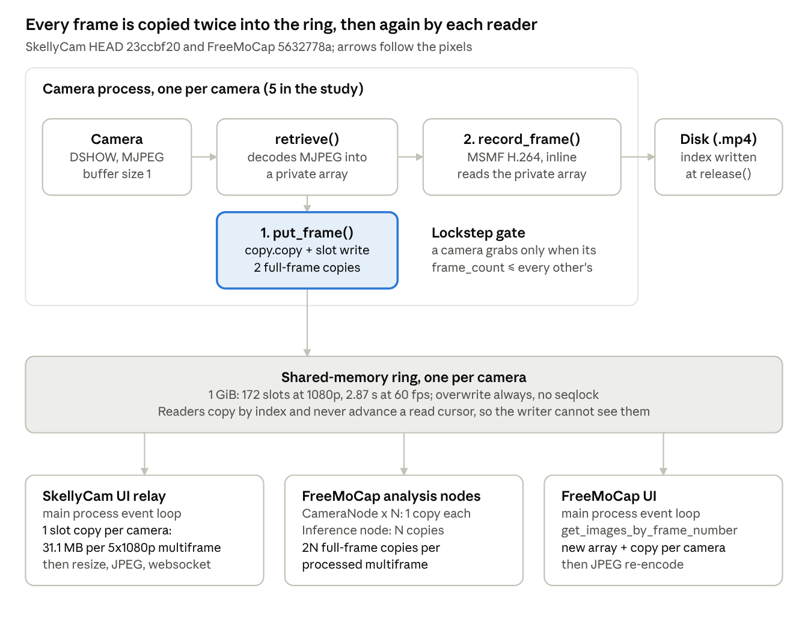
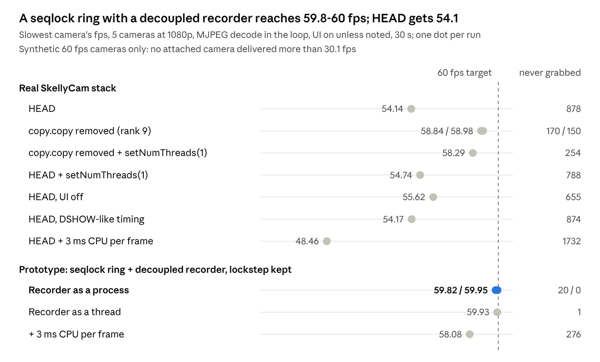

# Frame ring buffer summary

2026-10-28 · Dom

> Exported on 2026-10-28 from the online doc this study was first written in. This file is now the canonical copy; corrections made after export are marked "(corrected 2026-10-28; was ...)".

## Summary

A C++ port is not needed: the gains come from Python design changes. Removing one `copy.copy` in `put_data` raises 5 cameras at 1080p MJPEG + UI from 54.14 to 58.84 / 58.98 fps in the real SkellyCam stack. A decoupled recorder on a seqlock ring, with lockstep kept, reaches 59.82 / 59.95 fps (prototype).

- **P1, disk writes never drop.** The writer accepted every grabbed frame in 8 end-to-end runs. But sensor frames that are never grabbed go uncounted, and a crash costs the whole file: a killed MSMF .mp4 had 0 of 300 frames readable, MJPEG-in-MKV 298.

- **P2, 5 cameras at 60 fps.** HEAD reaches 53.56 / 53.57 fps at 5x1080p with the MJPEG decode, with 964 sensor frames (10.7%) never grabbed. Headroom after the fixes is small: 3 ms more capture CPU per frame drops the best design to 58.08 fps.

- **P3, no needless copies.** HEAD makes 2 full-frame copies per captured frame, 5 per UI multiframe (31.1 MB at 1080p) and 2N per FreeMoCap multiframe.

All 60 fps numbers use synthetic cameras; no attached UVC camera delivered more than 30.1 fps. Measured idle overnight 2026-10-27/28 at SkellyCam `23ccbf20`. Suggested order: ranks 9, 3, 4, 5 and 2 first (small effort), then rank 1, then ranks 6, 11 and 7 with 13 and 10.

## How frames move today

*Source: frame path at HEAD · write, record, 3 read taps · from study_state/verified_digest.json*

The recorder reads the camera process's private array, not the ring, so a slow encode delays that camera's next grab and, through lockstep, every camera. FreeMoCap attaches to the same rings by name, so its readers share the writer's overwrite-always rule.

## Measured baseline: idle re-run vs the provisional 25 Oct run

The idle re-run kept the verdict: HEAD misses 60 fps at 5x1080p with the MJPEG decode in the capture loop, at 53.56 / 53.57 fps instead of the loaded run's 44-47 fps. The loop body takes about 15.8 ms and the lockstep gate adds about 2.5 ms of idle, so a group frame takes 18.69 ms against a 16.7 ms budget.

| Metric (5 synthetic cameras, 60 fps target) | 25 Oct, loaded (provisional) | 28 Oct, idle |
|----|----|----|
| 1080p MJPEG + UI, fps per camera (2 runs) | 44.01 / 46.78 | 53.56 / 53.57 |
| 1080p MJPEG + UI, sensor frames never grabbed | 2398 / 1984 (about 25%) | 964 / 964 (10.7%) |
| 1080p MJPEG, no UI, fps (1 run) | 46.11 | 55.94 |
| 1080p MJPEG + UI, group interval median (ms) | 22.24 / 21.15 | 18.69 / 18.69 |
| 1080p MJPEG + UI, retrieve / put_frame / record_frame median (ms) | 11.22-12.27 / 4.07-4.23 / 1.30-1.34 | 10.12-10.31 / 3.64-3.73 / 1.12-1.19 |
| 1080p MJPEG + UI, sensor tick to written, median / p99 (ms) | 27.3 / 39.5 | 23.9 / 34.4 |
| 1080p memcpy (no decode) + UI, fps (2 runs) | 59.99 / 59.95 | 59.99 / 59.99 |
| 720p MJPEG + UI, fps | 59.99 | 60.00 |
| put_frame alone, 1080p, 5 writers: median (ms); slowest camera (fps) | 2.936; 337 | 2.747; 353 |
| MSMF recorder, 5x1080p paced, summed CPU (%) | 1169 | 1207 |
| UI relay, 1080p, payloads/s | 43.7 | 46.0 |

No grabbed frame was lost on the way to the writer in any of the 8 runs: files decoded to the recorded count and frames were consecutive. The loss happens before the recorder and goes uncounted; the finalizer passes and shows only "Mean Framerate 53.93 Hz".

The benchmark machine's DDR5 runs at 4000 MT/s against its 6400 rating; how much that lowers the memory-copy numbers was not tested (corrected 2026-10-28; was "which lowers the memory-copy numbers").

## What raises throughput

*Source: baseline/results/e2ev_summary.md and prototypes/results/p8v_e2e_summary.md · idle runs, 2026-10-28 · never grabbed = sensor frames summed over 5 cameras*

Removing `copy.copy` is the largest single step in the real stack. What is left is about 2.5-3.2 ms per frame of idle at the lockstep gate, which rank 13 targets. The +3 ms rows show how thin the margin is: real cameras used 11.0-14.7 ms CPU per 1080p frame at 30 fps, and at 60 fps this is unmeasured.

## Disk-write safety (P1)

The writer kept up in every run, but one crash loses the whole default file: a killed MSMF .mp4 had 0 of 300 frames readable. The index of a non-fragmented MP4 is written only at `release()`. MJPEG in MKV kept 298 of 300.

| Writer / container, 1080p | Clean stop | Killed while idle | Killed mid-write |
|---------------------------|------------|-------------------|------------------|
| MSMF .mp4 (HEAD default)  | 300        | 0                 | 0                |
| MJPEG in MKV              | 300        | 298               | 359              |
| NVENC, fragmented MP4     | 300        | 237               | 297              |
| NVENC, MKV                | 300        | 237               | 297              |

Frames decoded by cv2 after `TerminateProcess`; 300 written before the signal, mid-write runs kept writing for about 1 s.

**The disk keeps up.** C: had 224.9 GB free (94.38% used). With the SSD's write cache exhausted, 5 write-through streams paced at 162 MB/s achieved 162 MB/s, with a worst `write()` of 135 ms. At 69 MB/s (HEAD MSMF, 5x1080p) the worst was 138 ms. The free space fills in 54.3 min at 69 MB/s and 23.1 min at 162 MB/s (MJPEG passthrough).

**The risk is in the control code, not measured.** Any UI, websocket or FreeMoCap-node exception sets the global kill flag and ends the recording. 30 failed grabs or a camera config change mid-recording can also stall or end it. Fault behaviour was excluded by construction: the benchmark's UI stand-in catches every exception.

**Lockstep keeps a stall honest.** With a 3500 ms stall on 1 of 5 recorders, a blocking ring with lockstep recorded 445 frames on all 5 cameras, each skipping the same 36 sensor ticks. Without lockstep, camera 0 recorded 445 vs 481 and drifted up to 606 ms behind, and every frame-count check would still pass.

## C++ port verdict

Not needed. A line-by-line C++ port of `put_frame` is only 2-7% faster, because the cost is the algorithm (a fresh allocation and 2 copies), not the language. With the same one-copy seqlock design, numpy, pybind11, ctypes and pure C++ write within about 1-4% of each other.

| Comparison (1080p, 5 writers unless noted) | Python | C++ | Gap |
|----|----|----|----|
| HEAD algorithm, `put_frame` median (ms) | 2.765 / 2.780 | 2.694 / 2.662 | C++ 2-7% faster |
| One-copy seqlock write, median (ms) | 0.635 / 0.635 (numpy) | 0.637 / 0.630 | within 1-4% |
| Lossless writer-to-reader rate, slowest camera (fps) | 527 / 537 (numpy); HEAD 243 / 250 | 543 / 535 | same as numpy |
| Copy into the ring, 1 thread (GB/s) | 41.23 (`np.copyto`) | 42.37 (`memcpy`) | about 3% |
| JPEG decode at the same OpenCV 4.8.0 (ms) | 12.78 | 11.32 (copy), 10.36 (in place) | C++ 11-19% faster |
| Per-call overhead, 64x64 publish (µs) | 1.4 | 0.8 | irrelevant at 300 frames/s |

The library matters more than the language: Python's cv2 4.12 decodes 1.57x and encodes 4.9x faster than the C++ OpenCV 4.8 SDK. C++ decode against a current libjpeg-turbo 3.x was not measured, nor was a native capture callback or large pages. Keep the pybind11 ring (`cpp/src/cppring_py.cpp`) as the fallback if a non-x86 memory-ordering guarantee is needed. All runs idle, 2026-10-28.

## Ranked recommendations

Fifteen changes, ranked by priority served; five of the first nine are small (S or S-M) and can ship first. Ranks 1-5 make P1 failures contained and visible; ranks 6, 7 and 9 carry most of the fps gain. "Estimate" marks an effect that no benchmark measured.

| Rank | Change | Serves | Effect | Effort | Main risk |
|----|----|----|----|----|----|
| 1 | Contain failures: UI, websocket or FreeMoCap errors stop their own task, not the recording; one graceful-stop path | P1 | Estimate: no display or analysis error can cut a recording short | M-L | Real camera faults must still stop cleanly; swallowed errors must be shown |
| 2 | Crash-tolerant files (MKV or fragmented MP4), drain before terminate, free-space guard | P1 | A killed file keeps 298 of 300 frames (MJPEG MKV) instead of 0 (MSMF .mp4) | S-M | FreeMoCap's posthoc reader on MKV is untested |
| 3 | Never re-record a stale frame after 30 failed grabs | P1 | Estimate: a 30-grab stall no longer ends the app | S | A skipped frame is a real gap and must be counted |
| 4 | Guard recording state: no config apply, reopen or start race; no pause at stop | P1 | Estimate for the guards; the stop pause costs about 1 sensor frame per camera today | S | No exposure changes mid-recording |
| 5 | Count sensor drops live and fail validation on gaps | P1 | Accumulated clock finds 880 of 878 drops at HEAD; per-interval formula finds 16 | S | Accuracy on real cameras untested |
| 6 | Ring v2: per-slot seqlock, per-reader cursors, lossless gating | P1, P2, P3 | 0 torn reads vs 39,854-41,834 in the adversarial test; lossless 527-537 vs 243-250 fps per camera | L | x86 store ordering only; FreeMoCap must update in step |
| 7 | Decouple the recorder; it reads the ring through a lossless cursor | P1, P2 | 59.82 / 59.95 fps, 20 / 0 never grabbed (synthetic cameras) | L | 2-3 ms headroom; the ring is a 2.87 s stall budget at 1080p |
| 8 | Record the camera's MJPEG bitstream (passthrough) | P1, P2, P3 | 59.97 fps, 0 never grabbed (synthetic cameras); recorder CPU 19-20% vs 924-954% | XL | Larger files; no device opened passthrough at 60 fps |
| 9 | Remove `copy.copy` from `put_data` | P2, P3 | 54.14 to 58.84 / 58.98 fps; `put_frame` 3.61 to 1.29-1.38 ms | S | None found |
| 10 | `cv2.setNumThreads(1)` in recorder processes | P2 | Same 116 fps encode at 896% CPU vs 1826% | S | With the encode inline it costs about 0.5 fps |
| 11 | Retrieve straight into the next ring slot | P2, P3 | Publish 0.060 vs 2.618 ms; 0 vs 2 full-frame copies | M | Needs rank 6; 60 fps untested |
| 12 | UI tap: wake on new frames, build off the event loop from views | P2, P3 | 60.0-60.1 payloads/s at 1080p vs 46.0; drops 31.1 MB of copies per multiframe | M | No browser attached in the test |
| 13 | Cheaper control plane: numpy views, event-driven lockstep wake | P2 | After rank 9 the real stack still idles 2.5-3.2 ms per frame at the gate; P8's gate waited 0.03-6.4 ms median per camera | M | Event-wake latency not measured |
| 14 | `h264_nvenc` in the decoupled recorder, if H.264 is required | P2, P1 | Recorder CPU 105% vs MSMF 283%; 29.7 vs 124.9 Mbit/s per camera | M | NVIDIA only; a hard kill keeps 237 of 300 frames |
| 15 | FreeMoCap readers use validated views, not copies | P3 | Removes about 62 MB of copies per multiframe at 5x1080p; read 0.0333 vs 1.8365 ms | M | Long inference can be lapped after 2.87 s |

Suggested build order: ranks 9, 3, 4, 5 and 2; then rank 1; then ranks 6, 11 and 7 together with 13 and 10; then 12, 14 and 15. Rank 8 is a separate project.

## Open questions and next tests

The largest gap is real hardware: none of the 4 attached UVC cameras delivered more than 30.1 fps, so every 5x60 result is synthetic.

- [ ] Real 5x60 capture: per-frame capture-thread CPU at 60 fps and USB bandwidth with 5 real cameras. P9 measured 11.0-14.7 ms CPU per 1080p frame at 30 fps.

- [ ] Does DSHOW decode MJPEG on the calling thread? That decides whether a real camera behaves like the 53.6 fps (decode) or the 59.99 fps (memcpy) stand-in.

- [ ] Disk never-drop over a 10-minute 5x1080p60 recording through the real encoders, with Defender real-time scan and GC pauses. P12 measured raw write-through only.

- [ ] Build the rank-1 fault-injection test and rank 14's NVENC session-exhaustion and driver-reset handling; both are specified, not built.

- [ ] Does FreeMoCap's posthoc reader accept MKV and fragmented MP4, including a truncated last fragment (ranks 2 and 8)?

- [ ] Event-wake latency for the lockstep gate (rank 13).

- [ ] Accuracy of the accumulated-clock drop counter (rank 5) on real DSHOW cameras; on synthetic cameras it was within -2 to +5 frames (corrected 2026-10-28; was "within +5").

- [ ] Repeat key runs pinned to P-cores; placement on the 8 P-cores and 12 E-cores was not controlled.

- [ ] UI throughput with a browser attached; P6 and `d_ui` had none.

- [ ] Seqlock memory ordering on non-x86 CPUs: 0 torn frames in 50 runs on x86 is evidence, not proof.

## Evidence

The full report, with code references for every claim, is [Frame ring buffer study](frame_ring_buffer_report.md). Every number here comes from the files below, at SkellyCam `23ccbf20` and FreeMoCap `5632778a`. All paths are under `research/frame_ring_buffer/`.

| File | What it supports |
|----|----|
| `study_state/recommend_result.json` | Ranks 1-15, verdicts, build order (post-revision, authoritative) |
| `study_state/baseline_result.json`, `baseline/README.md` | Idle baseline, idle vs 25 Oct comparison, machine (DDR5 at 4000 MT/s) |
| `study_state/baseline_result_provisional_20261025.json`, `PROVISIONAL.md` | Provisional loaded-run numbers and the idle rule |
| `baseline/results/e_e2e_summary.md`, `baseline/results/e2ev_summary.md` | HEAD fps and the single-change variants in the real stack |
| `prototypes/results/p8v_e2e_summary.md` | Seqlock ring + decoupled recorder with lockstep, and the +3 ms run |
| `prototypes/results/p11_crash_container.md`, `prototypes/results/p12_disk_sustained.md`, `prototypes/results/p3v_asymmetric_stall.md` | Crash readability, sustained disk writes, stall behaviour |
| `prototypes/results/p9_real_camera.md` | Real cameras: 30.1 fps maximum |
| `study_state/cpp_result.json`, `cpp/results/cpp_comparison.md` | C++ port comparison |
| `study_state/verified_digest.json` | Verified write, read, UI and FreeMoCap paths and copy counts |
| `study_state/revision_result.json`, `revision/README.md` | 34 critic issues: 30 resolved, 4 partly |
| `reproducibility/comparison.md` | Re-run within 15%: 8 of 8 e2e and 8 of 8 P8 throughput rows |

To re-run any stage, set `FRAME_PIPELINE_RESULTS_DIR` first, or the scripts overwrite the cited results.
