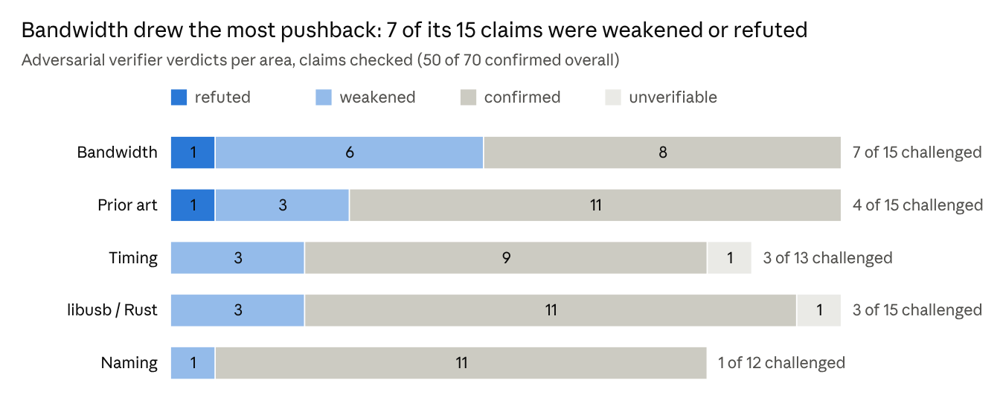

# USB camera tests summary

2026-10-28 · Dom

> Exported on 2026-10-28 from the online doc this study was first written in. This file is now the canonical copy; corrections made after export are marked "(corrected 2026-10-28; was ...)".

## Summary

Most earlier USB camera findings held up in the unattended overnight rerun on Gerald, and every camera stayed healthy. The run went from 03:03Z to about 04:50Z on 2026-10-28 (23:03 local on 10-27 until shortly before 01:00). It covered the C922, C930e and generic 4C4A:4A55 camera. The Razer Kiyo Pro was excluded.

Five areas are covered here: naming, timing, bandwidth, libusb/Rust and prior-art libraries. Each had a rerun agent and an adversarial verifier that re-ran key hardware tests itself. MJPEG was the sixth area and has its own doc, "MJPEG passthrough summary".

Four results changed in ways that matter:

- The C922 at MJPEG 1080p@5 delivered 5.01, 15.76 or 30.0 fps at the same alt setting. The rate is not deterministic.

- C930e manual exposure set through MF before streaming was applied in only 1 of 5 valid runs.

- The C930e PTS step follows one of two frame-period modes. What triggers each mode is unknown.

- The xHCI frame/QPC mapping is exact only for about 2–3.5 s. Over 20 s it shifts by up to -641 µs, so the phase-2 SCR-SOF to QPC agreement needs re-checking.

No change is shown to come from the dark room or machine load; only the bandwidth byte-rate ratios might follow the scene. Nearly every capture ran at forced manual exposure, and machine CPU was mostly 2–21%.

## What ran and what was skipped (and why)

76 rerun tests ran across the five areas, and 73 passed. Every test ran that needs no admin rights, no person and no driver change. The verifiers then re-ran key hardware tests under the camera lock.

| Area | Rerun window (UTC, 10-28) | Tests | Passed | Not passed |
|----|----|----|----|----|
| libusb / Rust | 03:04–03:40 | 22 | 20 | nokhwa all-three capture failed: generic got 0 frames (0x800718CF, shared hub). libuvc `example.exe` not run: it would open the Kiyo |
| Bandwidth | 03:04–03:43 | 19 | 19 | — |
| Timing | 03:04–03:43 | 15 | 14 | Flash run d invalid: 50 display refresh glitches; repeated as run e |
| Prior art | 03:07–03:40 | 11 | 11 | — |
| Naming | 03:03–about 03:20 | 9 | 9 | — |

Skipped by design, and why:

- **WinUSB driver swaps** (phase 2/3 streaming, alt sweeps, libuvc/pyuvc streaming, SCR/SOF timing on libusb). These need admin, a UAC prompt and a replug.

- **Elevation or registry writes** (UVC metadata scripts, ETW, Frame Server CPU). Not run unattended.

- **Device restarts** (pnputil, `devrestart.exe`, restart scripts). LogiTune vetoes them and leaves the camera needing a replug.

- **Anything needing a person** (controlled reboot, same-port replug, port move). Two unattributed reboots on 10-27 gave only opportunistic naming evidence.

- **Kiyo-specific tests, and tools that open every camera** (SDL3, openpnp-capture, `gst --list`, unfiltered pyuvc, `cv2.VideoCapture(index)`). The Kiyo was excluded as known flaky.

- **Three-camera flash run.** The C930e and generic camera cannot both stream 720p MJPEG on their shared hub.

- **LogiTune-free C930e test.** LogiTuneUpdater respawned the agent within seconds, and stopping the service was not approved.

## Re-confirmed findings per area

The verifiers confirmed 50 of the 70 claims they checked; 16 were weakened, 2 refuted and 2 could not be verified. Most weakenings corrected a number or its wording; the core hardware results held in every area.

*Source: results/agent_reports/rerun_20261027_reports_and_verifications.json · verifier verdicts for 5 areas (MJPEG excluded)*

| Area | What held (key numbers) |
|----|----|
| Naming | Descriptor bytes identical to phase 1 on 3/3 cameras. Only the C922 has a serial (B76395EF). Persistent identifiers of the C922 and generic camera survived two unattributed reboots; only the USB address changed. `camera_identity.py` takes 0.095–0.102 s in-process. 46/46 offline claim checks pass. |
| Timing | UVC PTS/SCR arrive through MF on every C922 (292/292) and C930e (287/287) frame; the generic camera has none (0/254). C922 PTS scores 0.47–0.68 ms against ground truth (the method's floor, not proven PTS accuracy), OS timestamps 4.4–5.0 ms. Rolling-shutter slope is 30.1–31.5 ms. |
| Bandwidth | usbvideo picks the same alt in 32/32 camera-mode cases. C930e alt 8 + generic passes 5/5; alt 9 fails 5/5. The USB 2.0 80% budget model predicts 26/26 outcomes. With a 2.5 s stagger, the second camera always fails with 0x800718CF. |
| libusb / Rust | libuvc builds on MSVC (exit 0, 11 warnings). Unit tests pass 23/23, 24/24, 5/5 and 9/9. libusb still cannot open cameras on usbvideo. nokhwa MSMF gives native MJPEG: 593/593, 588/588 and 515/515 frames. |
| Prior art | GStreamer mfvideosrc gives native MJPEG (172/172, 167/167, 154/154 frames). ksvideosrc PTS is arrival minus one frame (33.42–33.43 ms). OS timestamps are quantized to 16 ms. pygrabber still offers RGB24 only. |

Frame counts are listed C922, C930e, generic in that order.

## Changed or refuted findings, and whether light/load explains them

Fifteen results changed in these five areas. None is shown to come from the dark room or machine load, though the bandwidth byte-rate ratios might follow the scene. Nearly every capture forced manual exposure (-7) with AE priority 0, so low light could not lower fps. Machine CPU was mostly 2–21%, with brief peaks of 57–60%.

| Finding | Before → overnight | Likely cause |
|----|----|----|
| xHCI frame/QPC mapping (libusb) | Residual 0 → shifts up to +117 µs (hc0) and -641 µs (hc1) after about 2–3.5 s; QPC non-causal in up to 208/396 samples | Earlier 0.33 s test was too short to see the driver re-anchor. The phase-2 SCR-SOF to QPC agreement (46–66 µs) needs re-checking |
| C930e manual exposure via MF (timing) | Assumed applied → applied in 1 of 5 valid -7 runs; reads back -5 after capture | A control set before stream start does not stick |
| C930e PTS step (timing) | 6 of 6 flash runs → 1 of 6 | Two frame-period modes (998,400 vs about 997,230 STC ticks/frame); trigger unknown |
| C930e OS-timestamp error (timing) | 8–12 ms → 4.7 ms | One run only; probably tied to the period mode |
| C922 MJPEG 1080p@5 rate (bandwidth) | 15.76 fps → 5.01 fps (rerun) and 30.0 fps (verifier, 5 of 5) | Camera or driver non-determinism; headroom at alt 5 is only about 1.17x |
| Shared-hub loser at stagger 0 (bandwidth) | Fixed → different loser in 3 of 4 over-budget combos | Start race |
| Reserved/used ratios, headroom (bandwidth) | e.g. generic 69.9 → 52.2x | Run-to-run noise; byte rates may follow the scene, but earlier luma was not recorded |
| C922 MF arrival-minus-sample median (libusb/Rust) | About 16.2 ms → 1.23 ms | Bimodal beat about every 12 frames; report both modes |
| rawusb enumeration (libusb/Rust) | Root hubs only → all 4 cameras | Patched crate |
| C930e DirectShow drift (prior art) | -4.5 ms/s → about -1.5 to -1.8 ms/s | -4.5 was the outlier; the rerun's +1.20 ms/s was a fit across a PTS step |
| mfvideosrc arrival−PTS (prior art) | 0.11–0.13 ms → 0.10–0.31 ms | Unknown; the verifier reproduced it at 2–5% CPU, so not load |
| Wallclock arrival−PTS (prior art) | About 30 ms → about 36.2 ms | Per-session clock offset, not latency |
| MF/DShow/OpenCV index order (naming) | C930e MF 7 → 6, DShow 7 → 2 | C930e devnode re-created after WinUSB rollback, plus reboots. Never select by index |
| C930e ContainerId (naming) | Stable → new v1 ContainerId at the same port | Same devnode re-creation |
| C922 timing offset (timing) | Shifted about 1.4 ms between days | Possibly the monitor layout change |

Two of the rerun's own safety claims were also corrected: the Kiyo was contacted, though never streamed (see the next section).

## Camera health through the night

All four cameras were healthy at every check, through the final read-only check at 04:53Z. Functions read DevNodeStatus 0x0180200A and composite parents 0x0180600A, with problem code 0 and DN_NEED_RESTART never set. No device was restarted, disabled or removed, and nothing ran elevated.

- **Only failures:** the expected bandwidth refusals when the C930e and generic camera stream together on their shared USB 2.0 hub (MF 0x800718CF, DirectShow OSError 5). Twice, MF briefly could not find the generic camera right after such a refusal.

- **Generic camera re-arrived twice, unexplained:** at 03:18:48Z and 04:12:37Z, while capture agents were running. No agent reported a disconnect, and no Kernel-PnP events were logged. It came back healthy each time; only its USB address changed (11 → 15). Worth watching.

- **Kiyo stayed healthy but was contacted.** It was never streamed or opened through MF, DirectShow or libusb. But libusb and rawusb enumeration sent hub requests to it, including a config-descriptor read. GStreamer ksvideosrc opened a handle on it in all 3 of its runs before matching the device name. Its arrival time (18:39:51Z) never changed. While the Kiyo is excluded, ksvideosrc must be skipped too.

- **Reboots before the run, LogiTune during it:** two unattributed reboots on 10-27 (boot at 14:26:08Z and 18:39:40Z). LogiTuneAgent was closed three times overnight and respawned within seconds each time.

## What still needs a person + next steps

Six kinds of test still need a person or other hardware; five more can run unattended next time.

Needs a person:

- [ ] WinUSB phase 3 on the C922 and generic camera: one announced UAC prompt, then replugs.

- [ ] Controlled naming stability: reboot, same-port replug, and a port move of the serial C922.

- [ ] Kiyo-dependent tests (SDL3, openpnp-capture, `gst --list`, ksvideosrc, libuvc `example.exe`, unfiltered pyuvc, `cv2.VideoCapture(index)` mapping): unplug the Kiyo first, or re-include it.

- [ ] Elevated runs: Frame Server CPU and ETW probe/commit sizes.

- [ ] LogiTune-free C930e exposure test: needs the LogiTune updater service stopped.

- [ ] Linux and macOS runs of every draft.

Can run unattended (missed overnight):

- [ ] Re-check the phase-2 SCR-SOF to QPC agreement, with `uvc_capture_test --frame-qpc-only` over more than 3 s.

- [ ] C930e: re-apply exposure after stream start, to test the period-mode trigger.

- [ ] C922 MJPEG 1080p@5 repeats, and `--arrivals` inside the shared-hub combos.

- [ ] Generic camera timing in a brighter scene, with a ground truth that is not circular.

- [ ] `verify_grid_phase.py`, the non-Kiyo legs of the `kiyo_lens` probes, unpatched rawusb, and the Docker libuvc build.

Open question: what causes the generic camera's two unexplained re-arrivals?

## Evidence

Full investigation report: [USB camera investigation](usb_camera_report.md). Run `wf_ef322d5c-d99`. Short folder names after the first path in a line sit in the same results/windows/Gerald/ folder. All paths are relative to `research/usb_cameras/`.

- Consolidated results, skipped tests, camera health: `results/windows/Gerald/RERUN_20261027.md`

- Per-area rerun and verification (tests, claims, verdicts): `results/agent_reports/rerun_20261027_reports_and_verifications.json`

- Earlier claims compared against: `results/agent_reports/phase1_reports_and_verifications.json`, `results/agent_reports/phase2_reports_and_verifications.json`

- Status and machine state: `PROGRESS.md` (section "Overnight rerun 20261027")

- Naming: `results/windows/Gerald/naming_rerun_20261027/` (`check_claims.json`, `boot_events_since_20261025.json`)

- Timing: `results/windows/Gerald/timing/rerun_20261027/`, `results/windows/Gerald/timing/rerun_20261027_verify/`

- Bandwidth: `results/windows/Gerald/bw_concurrency_rerun_20261027/`, `bw_topology_rerun_20261027/`, `bw_rerun_20261027_analysis/`, `bw_adversarial_verify_20261028/`

- libusb / Rust: `results/windows/Gerald/*/20261028T03*_rerun20261027*`, `verify_rust/20261028T034322Z_adversarial_rerun20261027/`, `uvc_capture_frame_qpc_only/20261028T0350Z_verifier_rerun20261027/` and `uvc_capture_frame_qpc_only/20261028T0353Z_verifier_rerun20261027_20s/`

- Prior art: `results/windows/Gerald/prior_art_rerun_20261027/`, `prior_art_rerun_20261027_adversarial_verify/20261028T034622Z_gst_mf_pyav_ks/`
