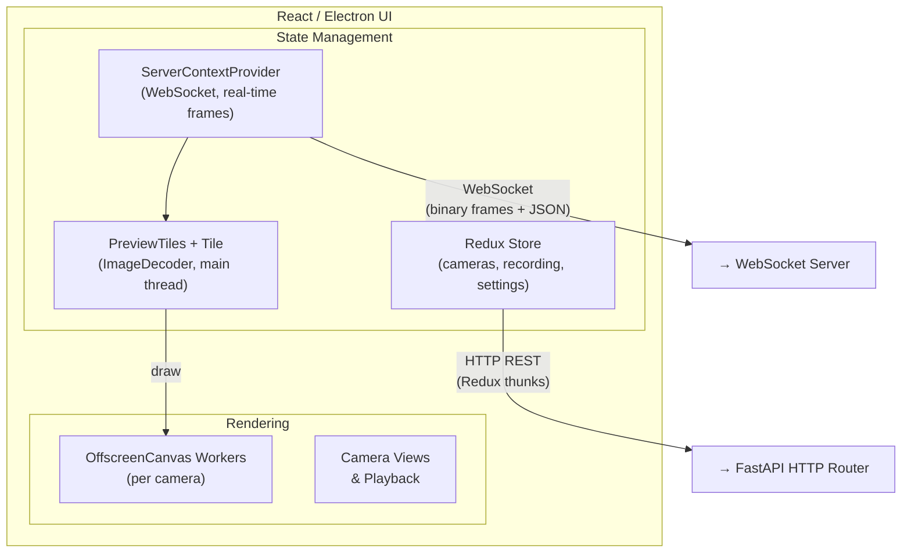
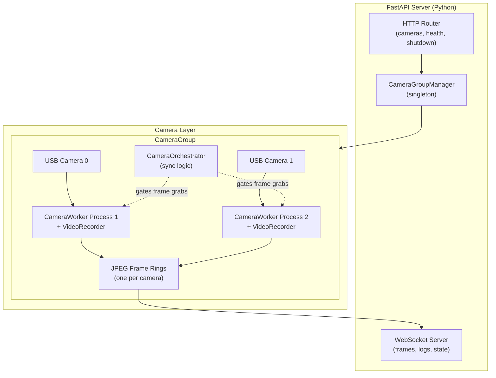
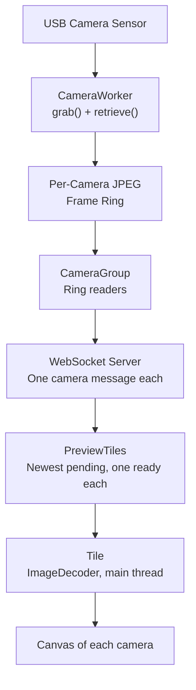

import { AiGeneratedBanner } from '@freemocap/skellydocs';

<AiGeneratedBanner />

# Architecture

## System Overview

SkellyCam is a client-server application with two main components:

1. **Python Server** (`skellycam/`) — A FastAPI/Uvicorn server that manages cameras, captures frames, records video, and streams data over WebSocket.
2. **React/Electron UI** (`skellycam-ui/`) — A frontend that displays live camera feeds, provides configuration controls, and manages recordings.

What is a client-server application?

A client-server application splits work between two programs: a **server** that does the heavy lifting (in this case, controlling cameras and processing video) and a **client** that provides the user interface. They communicate over a network protocol — here, HTTP for commands and WebSocket for streaming data. This separation means you could replace the UI with your own, or run the server on a different machine entirely.

Learn more: [Client-server model (Wikipedia)](https://en.wikipedia.org/wiki/Client%E2%80%93server_model)

### UI Layer

[//]: # (HUman NOTE - This diagramis ugly but functional)

### Server Layer

[//]: # (Human NOte - The camera layer should be INSIDE the server block, the USB Cameras should OUTSIDE the server blovk )

What is FastAPI?

[FastAPI](https://fastapi.tiangolo.com/) is a modern Python web framework for building APIs. It runs on [Uvicorn](https://www.uvicorn.org/), an ASGI server. SkellyCam uses FastAPI for its HTTP endpoints (camera control, health checks) and WebSocket connections (live frame streaming).

Learn more: [FastAPI documentation](https://fastapi.tiangolo.com/)

## Hot, Hard, and Soft Loops

SkellyCam's architecture is organized around a core principle: **protect the time-critical camera operations from everything else**. We classify operations into three categories:

### Hot loops — time-critical

Operations where any delay directly degrades temporal fidelity. These are the camera capture loops: reading from the camera sensor, frame synchronization gating, and shared memory writes. Hot loops run in isolated processes with minimal dependencies. Nothing is allowed to block them.

The entire [frame synchronization system](/docs/technical/frame-synchronization) is a hot loop.

### Hard loops — correctness-critical

Operations where the math must be internally correct, but timing is flexible. Post-hoc processing task such as timestamp computation and post-recording finalization fall here. A bit of delay is fine, but an off-by-one error in frame counting is not. Processing speed is a 'nice-to-have' for hard-loops, its important for User happiness but we'll happily trade time for accuracy when necessary.

### Soft loops — best-effort

Operations where a few milliseconds of jitter or delay is acceptable. The UI rendering pipeline, WebSocket streaming to the frontend, and log forwarding are all soft loops. If the frontend lags behind, frames are dropped from the stream — but the recording and capture pipelines are never affected.

Playback is also a soft-loop, specifically following a 'eventual consistency' approach to the rule that we should always display the same frame number for each camera. In some cases (i.e.  users aggressively moving the playback slider) could cause desync in frame view, but we can catch this up once the UI settles.

---

This classification drives key architectural decisions: each camera runs in its own process (protecting hot loops from the GIL and from each other), shared memory ring buffers use overwrite semantics (soft loop consumers can't block hot loop producers), and recording happens synchronously within the camera process (keeping it in the hot loop rather than adding IPC latency).

These concepts also drive development governance - we must be very protective of contributions that touch the hot/hard loops, less so of stuff that only touches soft-loops

## Process Model

SkellyCam uses Python's `multiprocessing` module to run each camera in its own process. This avoids the GIL and ensures that slow cameras do not block fast ones.

What is the GIL?

The Global Interpreter Lock (GIL) is a mechanism in CPython that allows only one thread to execute Python bytecode at a time. This means Python threads cannot achieve true parallelism for CPU-bound work. By using separate processes instead of threads, each camera gets its own Python interpreter and its own GIL, enabling true parallel execution.

Recent update to Python since version 3.13 have loosened the the GIL constraint. Python 3.14 introduces the 'SubInterpretter' class, which purports to offer `multiprocessing.Process`-levels of parrallelization with `threading.Thread` level start-up time and resource draw.   These Features are too new to incorporate into SkellyCam (and FreeMoCap), but when they mature they may lead to significant overhaul (and improvement) of the SkellyCam architecture!

Learn more: [GIL (Python Wiki)](https://wiki.python.org/moin/GlobalInterpreterLock)

### Main Process

The main process runs the FastAPI/Uvicorn server and manages:

- **WorkerRegistry** — Tracks all spawned worker processes and provides a heartbeat mechanism for health monitoring.
- **CameraGroupManager** — Singleton that creates/destroys camera groups and routes API calls to the correct group.
- **WebSocket Server** — Sends one binary camera message for each frame of each camera that it sends: the JPEG of the frame ring, untouched (no resize, no encode, no rotation), after a header of 48 bytes. For each connection, `PreviewRelay` sends a camera its next frame when the client has drawn the last one, with a safety net of 1 s. JSON messages (logs, state updates, framerate statistics) are encoded with [msgspec](https://jcristharif.com/msgspec/) for fast serialization.

### Camera Worker Processes

Each camera gets its own `CameraWorker` running in a separate `multiprocessing.Process`:

1. **OpenCV Capture Loop** — Calls `cv2.VideoCapture.grab()` and `.retrieve()` in a coordinated two-phase protocol, with synchronization gating between cameras.
2. **Frame Metadata** — Each frame is annotated with slim camera identification (camera ID, index, rotation, color channels) and high-resolution `perf_counter_ns` timestamps at multiple lifecycle stages (pre-grab, post-grab, pre-retrieve, post-retrieve, pre/post JPEG encode, pre/post record). The full camera configuration lives in the `CameraGroup`'s config dictionary — only the fields needed per-frame are embedded in the metadata.
3. **JPEG Encode and Capture Check** — The loop encodes each frame with `cv2.imencode` at quality 90. The capture check (`check_jpeg`) then sets the error flags of a cut-off frame.
4. **Video Recording** — When recording is active, frames are written to `cv2.VideoWriter` directly in the camera process, gated by the orchestrator's recording frame boundaries. The recorder gets each frame before the ring write.
5. **Frame Ring Write** — The loop writes the JPEG to the frame ring of the camera (`FrameRingWriter`). A ring write never blocks or waits. A failed ring write does not stop capture or recording.

For the full capture loop internals, see the [Frame Synchronization](/docs/technical/frame-synchronization) reference.

## Data Flow: Capture to Display

1. **Camera → Frame ring** — Each camera worker writes the JPEG of its frame into the frame ring of the camera.
2. **Frame rings → PreviewRelay** — For each connection, `PreviewRelay` reads the newest frame of each ring on its own, so a camera that reopens does not hold back the other cameras.
3. **PreviewRelay → WebSocket** — The JPEG of each frame goes into its camera message unchanged. The frames are full size. The header carries the rotation, and the tile turns the image.
4. **WebSocket → Frontend** — The server sends one camera message for each frame of each camera that it sends, and waits for the ready message of that camera, with a safety net of 1 s. `PreviewTiles` gives the newest message of each camera to its tile; the tile decodes the JPEG with `ImageDecoder` and draws it on the main thread.

## Data Flow: Recording

When recording is active:

1. Each camera worker writes frames directly to a `cv2.VideoWriter` in its own process, gated by `should_record_frame_number()` checks against the orchestrator's shared recording frame boundaries.
2. Per-frame timestamps are accumulated in memory and flushed to CSV when recording stops.
3. After recording completes, the `RecordingFinalizer` processes the timestamp data, computes inter-camera synchronization statistics, and saves summary reports.

## IPC Mechanisms

### Frame Rings

Frame data goes between processes in frame rings. A frame ring is one `multiprocessing.shared_memory.SharedMemory` block for each camera. It holds a ring header, a table of 64-byte slot headers and fixed slots. The file `specs/frame-ring.md` of the repository gives the layout and the rules.

- The main process creates each ring when the cameras report their opened configs. It logs the size of each ring and the total. It unlinks each ring at the end of the session.
- A change of resolution or frame rate makes a new ring with a new name. Frame numbers start at 0 in each new ring.
- The `SetShmMessage` topic gives a `CameraRingInfo` for each camera to the camera processes. `CameraGroup.ring_infos` holds the same information.
- The camera process is the one writer of its ring. The writer overwrites the oldest slot. It never waits for a reader. This protects the hot loop from soft loop latency.
- A reader (`FrameRingReader`) copies the slot header and the JPEG out of the block. Then it checks two CRC-32 values on its copy. A reader never writes to the block.

What is shared memory?

Shared memory is a region of memory that multiple processes can access directly. This is much faster than sending data through pipes or queues. In SkellyCam, the camera process writes each JPEG frame to shared memory one time. A reader copies the frame out one time and checks it.

Learn more: [Shared memory (Wikipedia)](https://en.wikipedia.org/wiki/Shared_memory)

### PubSub

[//]: # (Similarly, we should move the pubsub to its own section and add more detail. We should specifically note that we lifted the structure straight from ROS2 &#40;and link to their concept docs, make sure its the latest docs&#41;. We should also note that we might move this pubsub system to its own utility repo someday &#40;skellypubsub or something&#41;)

A lightweight publish/subscribe system built on `multiprocessing.Queue` is used for non-frame data like framerate updates, recording info, and camera setting changes. Topic messages and topic managers are implemented as dataclasses for the same reasons as the shared memory layer — they carry multiprocessing primitives and are never serialized to JSON.

### Global Kill Flag

A `multiprocessing.Value("b", False)` shared across all processes. When set to `True`, all camera workers and the server begin graceful shutdown.

### Runtime Type Safety

[beartype](https://beartype.readthedocs.io/) provides O(1) runtime type checking across the entire `skellycam` package. Every annotated function and method is automatically wrapped at import time — when a type violation occurs, beartype raises an exception immediately at the call site rather than allowing silent corruption to propagate.

This is especially valuable in a multi-process architecture where bugs can be difficult to trace across process boundaries. Type annotations in SkellyCam are contracts, not just documentation.

What is runtime type checking?

Python's type hints (like `def foo(x: int) -> str`) are normally ignored at runtime — they're just documentation for tools like mypy. Runtime type checkers like beartype actually enforce these hints while the code runs: if you call `foo("not_an_int")`, beartype raises an error immediately instead of letting the wrong type propagate through your program until something eventually breaks in a confusing way.

beartype achieves this with near-zero overhead by generating optimized checking code at decoration time and by spot-checking container contents (e.g., randomly sampling elements of a large list) rather than exhaustively validating every element.

Learn more: [beartype documentation](https://beartype.readthedocs.io/)

## Frontend Architecture

The React UI separates real-time streaming data from user-driven state:

- **Redux Toolkit** — Manages user-driven state: camera configurations, recording status, settings, and theme. HTTP API calls to the server are dispatched as Redux async thunks.
- **ServerContextProvider** (React Context) — Manages the WebSocket connection and real-time frame data. This is deliberately kept outside Redux to avoid triggering React renders on every frame.
- **PreviewTiles** — Reads each camera message (`parseCameraMessage`), keeps the newest pending message of each camera, gives each tile one update at a time on `requestAnimationFrame`, and sends one `camera_ready` for each draw.
- **Tile** (`skellycam-ui/src/player/`) — The shared tile of the player and the preview: it decodes the JPEG with `ImageDecoder` and draws it with its overlay (camera list label, rate, state) on the main thread.
- **Non-Redux stores** — `FramerateStore` and `LogStore` are ref-based mutable stores for high-frequency data that doesn't need to trigger React renders.
- **Material UI** — Component library for the control panels, tree views, and layout.
- **i18next** — Internationalization with community-maintained translation files.
